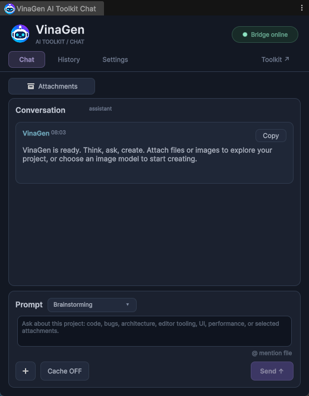

# AI Chat & Providers

Use Agent Chat to ask questions and create content with your own AI provider.

## Set up

1. Open **Tools → VinaGen AI Toolkit → Open → Settings → AI Provider Settings**.
2. Select a provider and enter your credentials.
3. Choose a model available to your account.
4. Open **Tools → VinaGen AI Toolkit → Chat**.

### Get an API key

| Provider | Where to get a key | Environment variable |
| --- | --- | --- |
| Gemini | [Google AI Studio → API keys](https://aistudio.google.com/app/apikey) | `GEMINI_API_KEY` or `GOOGLE_API_KEY` |
| OpenAI | [OpenAI Platform → API keys](https://platform.openai.com/api-keys) | `OPENAI_API_KEY` |
| Poe | [Poe → API key](https://poe.com/api_key) | `POE_API_KEY` |

Create a key on the provider's site (or click **Get API Key** in Settings) and paste it into **API Keys**. Note: OpenAI needs credit on your account first.

Chat keeps your history and attachments, and replies in the language you write in. When generating screen text or labels, say which language you want.

More options are in [Settings](settings.md).

## Costs and data

- Chat and image generation use your provider's credits. Everything else works without AI.
- Your prompt and attachments are sent to your provider.
- Keep API keys private. Don't commit settings files containing them to Git.

To work from an external assistant, see [Create from Claude Code / Codex](create-from-chat.md).
