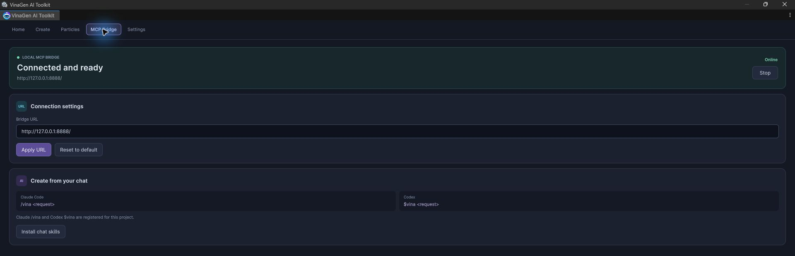

# Create from Claude Code / Codex

Ask your assistant to create UI screens, graphs or effects in your Unity project.

## Use it

1. Import the toolkit and wait for Unity to compile. Project chat skills and the `vinagen` HTTP MCP connection are registered automatically.
2. Open **Tools → VinaGen AI Toolkit → Open → MCP Bridge → Start**.
3. Open Claude Code or Codex in this Unity project.
4. Write a request with `/vina` (Claude Code) or `$vina` (Codex).

```text
/vina create a shop screen from the bundled Samples template, named Shop
$vina create a login flow with success and failure branches
$vina create a looping blue fire effect using offline textures
```

Say what you want, the style and a name. You can also give a save path, e.g. `Assets/VinaGen AI Toolkit/Content/UI/Documents/Shop.asset`.

The skill starts with `vinagen_find`: your request selects the tool/action, its focused schema and one guide. Requests can also cover Unity scenes, GameObjects, components, prefabs, C# compilation and tests, or a playable game with editable scene/prefab assets. After code changes the agent compiles and checks compiler/Console errors; gameplay still needs verification.

For UI edits, the agent reads the current revision, previews a targeted patch, then commits and captures the intended screens. Saved assets and unsaved browser drafts are separate. See [MCP Bridge](mcp-bridge.md) for discovery, draft targeting and the compile/test loop.

## Ask the agent to test a particle

```text
$vina create an offline particle, use Web Particle to capture startup, peak
and fade; inspect the images, fix issues and re-test the saved prefab.
```

The agent uses [Web Particle](webgl-preview.md) to look at its effect, then saves fixes in Unity.



## If the command is missing

In the **MCP Bridge** tab, click **Install chat skills**, then reopen the chat. Your own skills are not touched.

| Host | Project entry | MCP connection |
| --- | --- | --- |
| Claude Code | `.claude/skills/vina/SKILL.md` | `.mcp.json` → `mcpServers.vinagen` |
| Codex | `.agents/skills/vina/SKILL.md` | `.codex/config.toml` → `[mcp_servers.vinagen]` |

The default MCP URL is `http://127.0.0.1:8888/mcp`. Setup preserves unrelated servers and custom `vinagen` connections; existing loopback HTTP entries follow bridge URL changes. Check the installation result if an entry is skipped.

Assistant usage is billed to your Claude Code / Codex account.

[Next: MCP Bridge](mcp-bridge.md)
