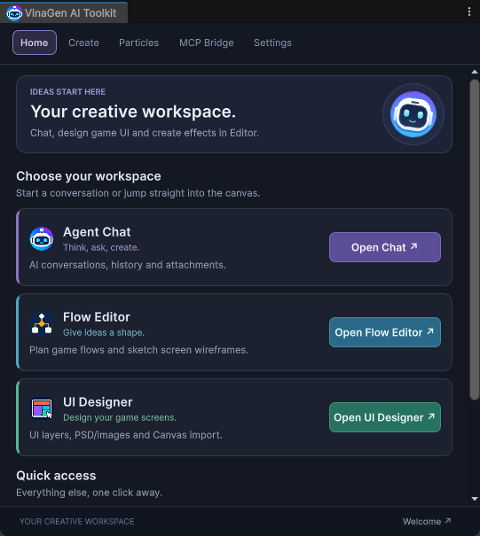

# Getting Started

> Import the toolkit, open the workspace and create your first graph, UI screen or effect in a few minutes.

## Step 1: Install

1. Open your project in **Unity 6000.3.22f1** (the validated version).
2. Install the official **Unity UI (uGUI)** package if you plan to use UI Designer, Canvas tools or text features. On Unity 6, TextMesh Pro is included in uGUI.
3. Import the `VinaGen AI Toolkit` `.unitypackage` (**Assets → Import Package → Custom Package…**).
4. Wait for Unity to finish importing and compiling.

Everything lives under one folder: `Assets/VinaGen AI Toolkit/`. You do not need any other project folder, Python, Node.js, npm, a CDN or a cloud login.

> **Without uGUI** the graph, texture, particle and bridge features still work; only the Canvas/UI integrations are disabled.

When UI Designer needs **TMP Essential Resources**, it imports them from the installed official package and waits for the import to finish. Existing TMP settings are preserved.

## Step 2: Open the workspace

Open **Tools → VinaGen AI Toolkit → Open**. The toolkit window has five tabs:

  <figure><figcaption>Home: choose a workspace.</figcaption></figure>
  <figure><figcaption>Settings: every project default in one place.</figcaption></figure>

| Tab | What you do there |
| --- | --- |
| **Home** | Choose a workspace: Agent Chat, Flow Editor or UI Designer, plus quick access to the bridge, particle tools and settings. |
| **Create** | Start something new in Agent Chat, Flow Editor or UI Designer. |
| **Particles** | Browse the Particle Texture Library and Bundled Particle Library, or repair materials for the active render pipeline. |
| **MCP Bridge** | Start/stop the local bridge, change its URL and install chat skills for Claude Code and Codex. |
| **Settings** | Open AI provider, graph appearance, design content, UI Designer, texture library and WebGL preview settings. |

**Tools → VinaGen AI Toolkit → Show Welcome Window** opens a lightweight launch pad with *Open AI Chat*, *Set up AI* and three workspace cards: **Design & code**, **Create visuals** and **Build effects**.

## Step 3: Pick a first workflow

<!-- tabs:start -->

#### **Flow graph**

1. Open **Tools → VinaGen AI Toolkit → Editors → Open Flow Editor**.
2. In the **Files** panel, create a new Flow graph inside an existing `Assets` folder.
3. Add nodes, drag from a port to connect them, label branches.
4. Click **Save asset**.

See [Flow & Design Graphs](graphs.md) and [Web Flow Editor](web-editor.md).

#### **UI screen**

1. Open **Tools → VinaGen AI Toolkit → Editors → Open UI Designer**.
2. Create a **New screen** or **Import** a PSD, JSON or images.
3. Label layers as Background / Image / Button / Text / Group (**Alt+1–5**).
4. Click the blue **Unity** button to import the Canvas.

See [UI Designer](ui-designer.md).

#### **Particle effect**

1. Open **Tools → VinaGen AI Toolkit → Particle System → Authoring Tools**.
2. Browse the bundled texture and particle libraries from the **Particles** tab.
3. Construct an effect from a composition, a texture alias or a prefab — manually or through the MCP bridge.
4. Review it in the [WebGL Particle Preview](webgl-preview.md).

See [Particles & Textures](particles.md).

#### **From AI chat**

1. Start the bridge in **Open → MCP Bridge → Start**.
2. In Claude Code type `/vina create a shop screen in Assets/MyUI/Shop.asset` (Codex: `$vina …`).

See [Create from Claude Code / Codex](create-from-chat.md).

<!-- tabs:end -->

## Step 4 (optional): Connect an AI provider

Open **Tools → VinaGen AI Toolkit → Settings → AI Settings**, choose a configured provider and a model your account can use. Model availability, quotas and pricing are controlled by the provider — the toolkit does not include provider credits.

Credentials are personal, Editor-only configuration. Never commit credential-bearing settings and never export them manually. See [AI Chat & Providers](ai-chat.md).

## Samples

The toolkit ships ready-to-open examples under `Samples/`:

| Folder | Contents |
| --- | --- |
| `Samples/Graphs` | `NewMockFlowGraph.asset` and `NewDesignContentGraph.asset`. |
| `Samples/Example VinaGenUIDocument` | A full UI document with fonts, images, styles and a scene. |
| `Samples/Particles` | Texture gallery, toon effects, reviewed recipes and original FX. |
| `Samples/GeneratedParticles` | Example generated prefabs such as `StraightFireballFX` and `toon_explosion`. |

---
[Next: Flow & Design Graphs](graphs.md)
