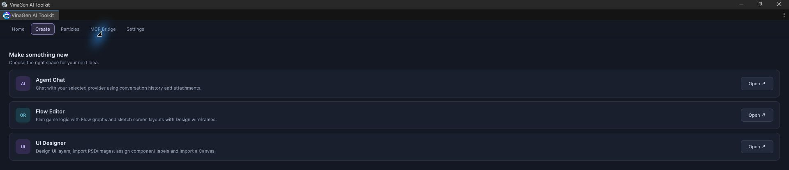

# Getting Started

Import the toolkit, open a workspace and try a bundled sample.

## Install

1. Import the `.unitypackage` through **Assets → Import Package → Custom Package…**.
2. Wait for Unity to finish compiling.
3. Open **Tools → VinaGen AI Toolkit → Open**.

Product page: [VinaGen AI Toolkit on the Unity Asset Store](https://assetstore.unity.com/packages/slug/375862). The first release is not published yet.

The project uses **Unity 6000.3.22f1**. UI and text tools need **Unity UI (uGUI)**; TMP Essentials are imported from the installed Unity package when needed. The local editors run inside Unity.

  <figure><figcaption>Home: open a workspace.</figcaption></figure>
  <figure><figcaption>Settings: configure project defaults.</figcaption></figure>

## Updates

[View updates on the Unity Asset Store](https://assetstore.unity.com/packages/slug/375862)

The toolkit checks [release information](https://vinagen.onrender.com/updateAvailable.json) in the background when Unity is ready, at most once every six hours. It announces each newer published version once per OS user, across Unity restarts and projects. Offline checks stay quiet; editing tools continue to work.

In Unity, **Open Package Manager** selects this asset so you can download/import its update. **View on Asset Store** opens the product page in your browser. These actions open the update destination; they do not install automatically. You can also use **Tools → VinaGen AI Toolkit → Help → Check for Updates** or **Update in Package Manager**.

## The five toolkit tabs

| Tab | Use it for |
| --- | --- |
| **Home** | Open Agent Chat, Flow Editor or UI Designer. |
| **Create** | Choose a workspace for new content. |
| **Particles** | Open libraries, manage the shared WebGL player and repair materials. |
| **MCP Bridge** | Start the bridge, inspect its URL and register chat skills. |
| **Settings** | Open settings assets in the Inspector. |

Create — Choose a workspace for new content.

Particles — Open libraries, manage the shared WebGL player and repair materials.

MCP Bridge — Start the bridge, inspect its URL and register chat skills.

See [Settings](settings.md) for each field and [Demos & practice](demos.md) to follow a sample.

## Pick a first task

| Task | Start here |
| --- | --- |
| Plan game logic | **Editors → Open Flow Editor** → open `Samples/Graphs/NewMockFlowGraph.asset`. |
| Sketch screens | In Flow Editor, open `Samples/Graphs/NewDesignContentGraph.asset`. |
| Build game UI | **Editors → Open UI Designer** → open the sample in `Samples/Example VinaGenUIDocument/`. |
| Explore effects | **Open → Particles** → open a texture or particle library. |
| Create with an assistant | **Open → MCP Bridge → Start**, then use `/vina` or `$vina` in your project chat. |

Paths in this table are relative to `Assets/VinaGen AI Toolkit/`. For editor menus, start at **Tools → VinaGen AI Toolkit**.

## Save your work

Use **Save asset** for graphs and **Save** for UI documents. Canvas import creates scene objects; save the scene yourself.

AI chat and provider image generation require your own account and credentials. Configure them in **Open → Settings → AI Provider Settings** when needed.

[Next: Flow & Design Graphs](graphs.md)
