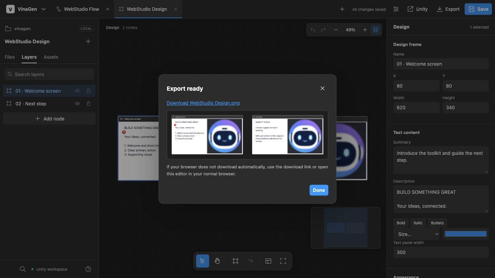

# Flow & Design Graphs

> Two graph asset types describe what your game **does** (flow) and what each screen **shows** (design). Both open in native Unity editors and in the shared browser workspace.

## Flow graphs (logic)

A **MockFlowGraph** asset models gameplay flow, state transitions and progression: nodes are steps and connections are transitions.

**Node kinds:** `Start`, `Action`, `Decision`, `End`, `Note` and `Image`.

### Create and edit

1. Open **Tools → VinaGen AI Toolkit → OpenGraphEditor** (native) or **Editors → Open Flow Editor** (browser).
2. Create or select a MockFlowGraph asset.
3. Add nodes, connect them and give every branch an explicit label (for example *Yes* / *No*).
4. Use selected-node edits for focused changes. Keep node IDs stable so later patches and AI edits stay precise.

The graph works **without FlowCanvas or NodeCanvas**. When those products are installed, optional reflection adapters activate automatically; they are never redistributed or installed by the toolkit.

### Ask vs. generate

In the native graph editor chat, **Ask** gives advice and copyable code. Graph generation belongs to the graph-creation action. Review generated nodes, branches, comments and connections before applying them to game logic.

Attach relevant files and images explicitly. Chat context can include the selected graph content, attachments and project excerpts assembled by the workflow — review the composed request when working with confidential content.

## Design content graphs (wireframes)

A **DesignContentGraph** asset describes screens: layout hierarchy, frame size and style, labels, copy, image slots and numbered callouts.

- Open **Tools → VinaGen AI Toolkit → Open Design Content Editor**, or open the asset in the browser Flow Editor.
- Frames carry rich text (bold, italic, color, size, bullet/checklist/numbered lists), reorderable image slots and draggable numbered callouts.
- Screen copy defaults to concise **English** unless the request provides text or explicitly asks for localization.
- Frame size, colors, fonts and callout style are configured in **Settings → Design Content Settings**.

## Canvas Design Capture Studio

With Unity UI installed, open **Tools → VinaGen AI Toolkit → Design Capture Studio → Inspector** and select the Canvas/UI hierarchy you want to work on. Inspect, capture or generate the requested design.

- Existing TMP fonts are kept when available.
- New UI falls back to native Unity UI **Text** when no TMP Essentials/font is configured.
- The bundled Noto Sans is a dynamic bitmap font. For SDF text, create a TMP font with TMP's Font Asset Creator and assign it as the project font.

## Export

From the browser workspace you can export:

| Format | Notes |
| --- | --- |
| **Markdown** | Uses the same native Flow/Design exporters, including callout details. |
| **JSON** | Preserves both native schemas and stable GUID + local-file-ID image references. |
| **SVG / PNG** | Exports the visible canvas with embedded images. |

---
[Next: Web Flow Editor](web-editor.md)
