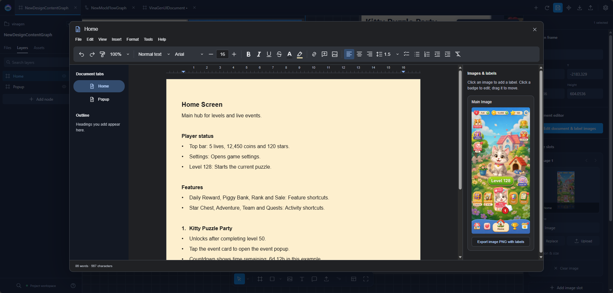

# Flow & Design Graphs

Use **Flow** to plan game logic and **Design** to sketch screens.

## Open

Choose **Tools → VinaGen AI Toolkit → Editors → Open Flow Editor**. Both graph types open in the same editor.

| Asset | Use it for |
| --- | --- |
| `MockFlowGraph` | Steps, decisions and branches. |
| `DesignContentGraph` | Screen sketches with text, images and numbered notes. |

## Build a flow

1. Create a Flow graph in **Files**, or open the sample.
2. Add Start, Action, Decision and End nodes.
3. Drag between ports to connect them. Label decision branches (e.g. **Yes / No**).
4. Click **Save asset**.

A flow graph is a plan — you still write the game code. FlowCanvas and NodeCanvas integrations are optional.

## Sketch screens

1. Open or create a Design graph.
2. Add frames, text and images.
3. Add numbered notes to explain what each part does.
4. Click **Save asset**.

Need real UI that imports into Unity? Use [UI Designer](ui-designer.md).

## Write screen specifications

Double-click a Design frame (or click **Document editor → Edit document & label images** in the Inspector).

<figure>
  
  <figcaption>Write screen behavior beside its reference image and numbered callouts.</figcaption>
</figure>

| Area | What it does |
| --- | --- |
| **Document tabs** | Switch between screens (e.g. Home, Popup). |
| **Outline** | Jump to a heading. |
| **Document and toolbar** | Write and format the spec. |
| **Images & labels** | Click the image to add a numbered label; drag to move it. |
| **Export image PNG with labels** | Download the image with its labels. |

Example: label **1** marks the event card; item **1** in the text explains how it unlocks and what tapping it does. Close the editor and click **Save asset**.

## Export

**Markdown** for written specs, **JSON** for data, **SVG / PNG** for images.

## Using an AI assistant

With [MCP Bridge](mcp-bridge.md) running, just ask in your project chat:

- `/vina create a login flow with success and failure branches`
- `/vina sketch a shop screen with an item list and a purchase popup`

The assistant can read, create and edit graphs, and write descriptions for your screen frames. Some actions (creating from a prompt, reviewing frames) use [AI Chat](ai-chat.md) and need an AI provider; reading and simple edits don't.

MCP tools for graphs

- Flow: `GET /graph?graphType=mock_flow_graph&graphPath=<asset>`, `import_mock_flow_graph`, `create_block_diagram`, `fix_block_diagram`
- Design: `GET /graph?graphType=design_content_graph&whiteFramePath=<asset>`, `patch_design_content_graph`, `create_white_frame`, `update_white_frame`, `check_white_frame`
- Context: `get_web_editor_context`, `get_node_context`, `get_document_metadata`

[Next: Web Flow Editor](web-editor.md)
