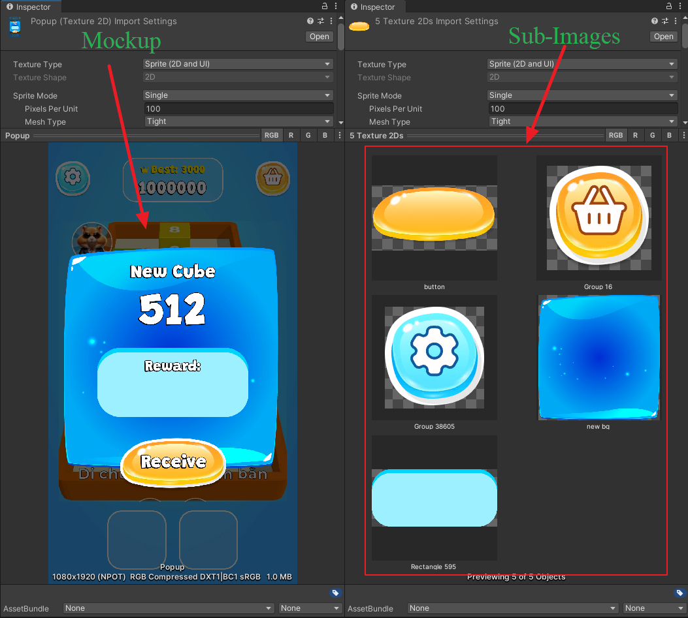
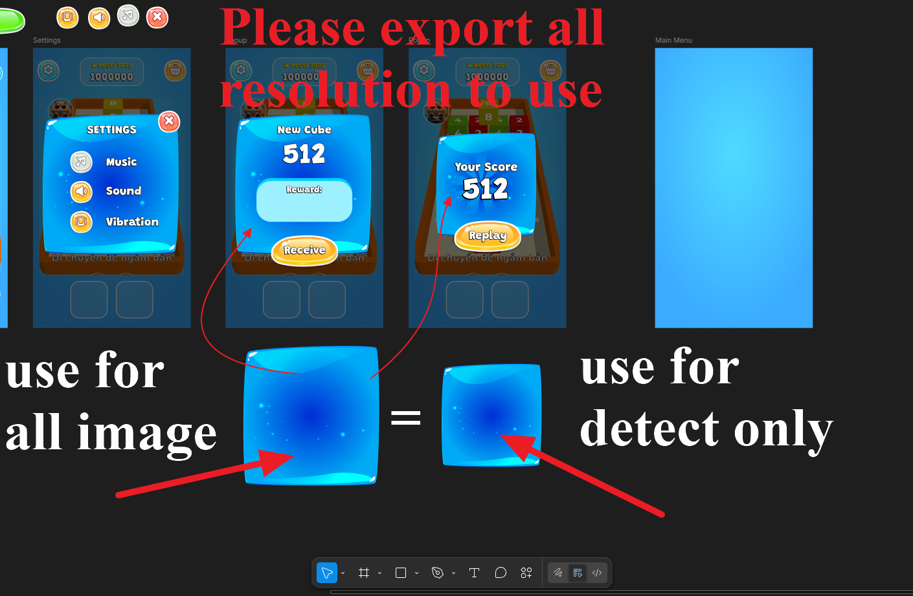

# What is Auto UI Generator?

> **Auto UI Generator** is a Unity Editor extension that transforms UI design mockups into fully functional, production-ready UGUI and UI Toolkit layouts — quickly, accurately, and entirely in-seconds.

  <iframe width="100%" height="450"
    src="https://www.youtube.com/embed/TvFjpDeIAV0?si=sDHGiqx3E9dNqk3Y"
    title="Auto UI Generator Demo"
    frameborder="0"
    allow="accelerometer; autoplay; clipboard-write; encrypted-media; gyroscope; picture-in-picture; web-share"
    allowfullscreen>
  </iframe>

Auto UI Generator creates a seamless bridge between design tools such as <strong>Figma</strong> and <strong>Photoshop</strong> and the <strong>Unity Editor</strong>.  
Design screenshots are analyzed and automatically converted into standard <strong>Unity UGUI (Canvas)</strong> components or modern <strong>UI Toolkit (UXML + USS)</strong> layouts, eliminating hours of manual layout work, anchoring, and positioning.

## Core Concepts

- **Mockup (Main Screenshot)**  
  A full design image representing the target UI layout you want to generate inside Unity.

- **Sub-Images (Template Assets)**  
  Individual UI element images extracted from the mockup or provided as separate sprites.  
  These are used for element detection, OCR, and template matching.

## ⚠️ Technical Limitations

Before getting started, please review the following requirements to ensure a stable and accurate generation workflow.

**Supported Operating System: Windows (Required)**  
The AI detection engine (`ui-detect.exe`) is optimized exclusively for Windows to guarantee fast image processing and reliable execution.

**Alpha Transparency**  
Sub-images must match their original source assets exactly.
Scaled, stretched, rotated, or re-rendered elements are not supported.

If a UI element exists in multiple resolutions (e.g., 1x, 2x, 3x), export each version separately.
The system will automatically validate them and select the highest-resolution match internally.
This guarantees optimal detection precision while minimizing unnecessary memory and processing overhead.

## 🚀 Get Started

Ready to generate your first UI?

- Follow the **step-by-step guide** for a full workflow breakdown  
- Or jump straight in with the **Quick Start** guide

👉 **Continue here:** [Getting Started](getting-started)
