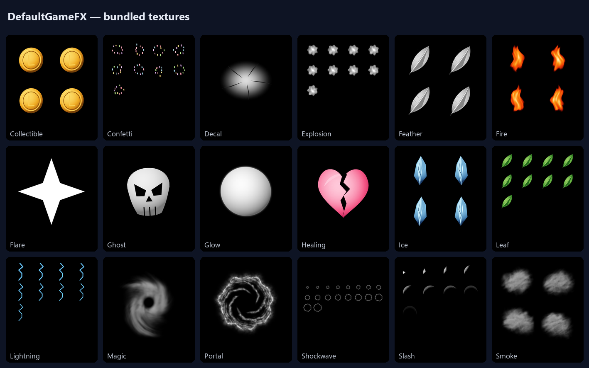
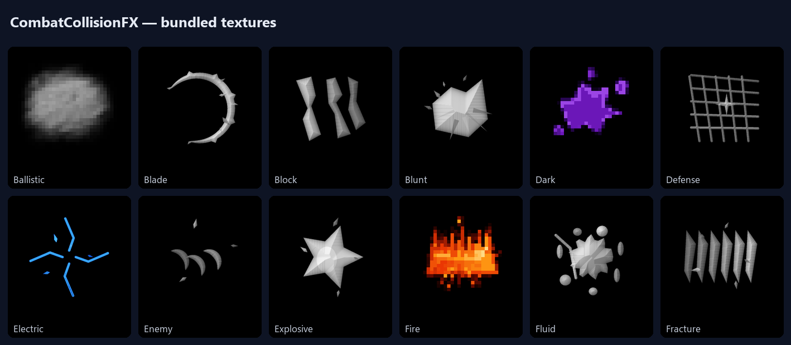

# Particles & Textures

> Build Unity particle systems from an **offline library of original textures** and bundled effect prefabs — with optional AI for missing artwork.



## Offline texture library

Five packs ship **403 textures**, all rendered by Unity C# from VinaGen-authored recipes, with no third-party artwork inputs and no imaging runtime. The complete particle release has 474 PNGs (audit of 2026-10-11).

| Pack | Textures | Categories |
| --- | --- | --- |
| **DefaultGameFX** | 82 | Collectible, confetti, decal, explosion, feather, fire, flare, ghost, glow, healing, ice, leaf, lightning, magic, portal, shockwave, slash, smoke, snow, sparks, star, trail, water |
| **ArtStylesFX** | 70 | Fire, glow, impact, lightning, magic, puzzle, slash, smoke, sparkle and splash across art styles |
| **GameEssentialsFX** | 71 | Combat, environment, fire, gameplay, magic, sci-fi, weather |
| **CombatCollisionFX** | 97 | Ballistic, blade, block, blunt, dark, defense, electric, explosive, fluid, fracture, frost, ground, magic, motion, space and more |
| **UniversalGameTextures** | 83 | Impacts, decals, environment, glow, status, object sprites, rewards, sci-fi, smoke, UI textures, utility masks, water, weather |



### Import contracts

| Texture role | Import |
| --- | --- |
| Particles | Opaque black background, additive rendering |
| Decals | Straight alpha |
| UI / objects | Alpha Sprite import |
| Surfaces / terrain | sRGB, repeat, mipmaps |
| Masks | Linear sampling, repeat, mipmaps |

General assets are excluded from automatic particle selection. Assign surfaces and masks to the right slot of your own material's shader.

## Bundled particle library

`Content/Particles/ToonLibrary` contains an independent library of **78 effect prefabs** with their materials, meshes and original artwork. Browse it from **Open → Particles → Bundled Particle Library**. The gallery under `Samples/Particles/Texture Gallery/` shows every reusable texture on a prefab.

## Authoring Tools

Open **Tools → VinaGen AI Toolkit → Particle System → Authoring Tools**.

| Tab / action | What it does |
| --- | --- |
| **Defaults → Generate** | Rebuilds bundled PNGs from the curated manifests. Existing files are skipped unless **Overwrite** is checked. |
| **Defaults → Audit** | Checks every atlas cell for padding, clipping, visibility at game size, noise, opacity and color policy; writes JSON and labelled review pages. |
| **Defaults → Register** | Registers textures in the library and creates pipeline-compatible additive materials. |
| **Poe Image → Generate** | Optional text-to-image generation through the Poe API (uses your Poe points). |
| **Inspect** | Filename inventory, read-only prefab analysis, alpha validation and GUID-preserving rename/resize. |
| **FX Review** | Creates or reviews a prefab, enters real Play Mode, captures delay/burst/lifetime milestones and restores the Editor. Save scenes first. |

Generation and analysis run as incremental Editor jobs with progress and cancel. Reports are saved under `Library/VinaGenNativeParticleTools/Jobs`. Keep Unity out of Play Mode until a job completes.

> Numeric audits detect defects; they don't prove visual quality. Always look at the sprite/atlas pages and the effect in motion.

### Datasets

`all` covers the five packs; `universal` and `combat` select a single pack, and `lowpoly` / `voxel` select those art tracks. For a review copy, write to `Library/VinaGenNativeParticleTools/Generated` instead of the bundled folders.

## Construct an effect

Choose one of:

- a **composition** (template),
- an explicit **texture alias**,
- a **source prefab**, or
- a structured **ParticleSystem specification**.

Then inspect the layer count, selected artwork, material issues and warnings. Use **white RGB** for colored artwork; tint grayscale masters and keep alpha fading.

Through MCP, `create_particle_system` defaults to **`web_preview`** output. Use **`scene_object`** to place it in the scene or **`prefab`** for asset-only output. See [MCP Bridge](mcp-bridge.md).

Generated prefabs, materials and captures go to `Assets/VinaGenParticles`.

## Missing artwork

Planning reports whether the catalog matches your subject. If a custom subject is missing, the toolkit returns an **image-generation plan** instead of substituting unrelated art. Generate the image with your assistant's image tool or a configured provider, import it and resume with its alias/job. Provider costs and artwork rights still apply.

Imported third-party artwork keeps its **source colors, shape and background**. The import applies only a quarter-turn rotation, optional dilation and light sharpening — this does **not** grant redistribution rights.

## Render pipelines

Built-in, URP and HDRP are supported for rendering. Run **Tools → VinaGen AI Toolkit → Particle System → Repair Materials For Active Pipeline** (also on the Particles tab) if particles render pink after switching pipeline.

## Batch generation

```text
Unity -batchmode -projectPath <project> -executeMethod FlowCanvasExporter.Editor.VinaGenParticleTools.BatchGenerate -vinagenDataset all -vinagenOutput Library/VinaGenNativeParticleTools/Generated
```

Add `-vinagenOverwrite` only for an intentional rebuild. Don't add `-quit` — the job exits Unity when complete. Never launch a second Unity process on a project that is already open.

---
[Next: WebGL Particle Preview](webgl-preview.md)
