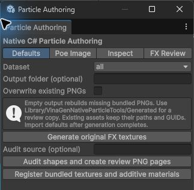
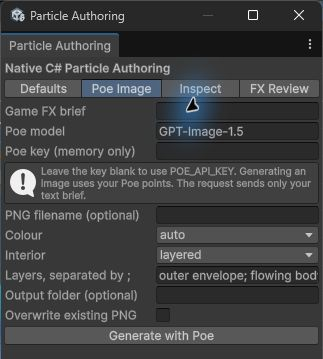
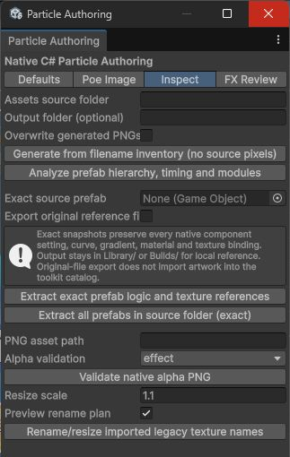
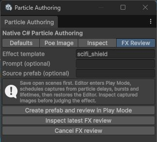

  <h1>Particles &amp; Textures</h1>
  
From texture to motion. Explore the effects, tune them in your browser, then build your own in Unity.

  
<strong>403</strong> offline textures<strong>78</strong> effect prefabsBuilt-in / URP / HDRP

## Try it in your browser

Pick an effect and explore it in motion. Use **Restart** to replay it, or lower **Time scale** to inspect each layer.

  
Effect collection8 interactive demos

  

    <button type="button" data-fx="toon_explosion" aria-pressed="true">Explosion<small>Burst &amp; sparks</small></button>
    <button type="button" data-fx="lightning_strike" aria-pressed="false">Lightning<small>Electric strike</small></button>
    <button type="button" data-fx="portal" aria-pressed="false">Portal<small>Magic loop</small></button>
    <button type="button" data-fx="toon_heal_burst" aria-pressed="false">Heal<small>Recovery burst</small></button>
    <button type="button" data-fx="toon_slash" aria-pressed="false">Slash<small>Blade trail</small></button>
    <button type="button" data-fx="toon_shield_hit" aria-pressed="false">Shield hit<small>Defense flash</small></button>
    <button type="button" data-fx="toon_smoke_burst" aria-pressed="false">Smoke<small>Soft particles</small></button>
    <button type="button" data-fx="rain_2d" aria-pressed="false">Rain<small>Weather loop</small></button>
  

  <iframe class="vg-fx-frame" src="playground/?fx=toon_explosion&replay=1&lang=en" title="VinaGen particle playground" loading="lazy" allow="fullscreen"></iframe>
  
Explosion — Burst &amp; sparks<a data-fx-open href="playground/?fx=toon_explosion&replay=1&lang=en" target="_blank" rel="noopener">Open full screen ↗</a>

  
11 MB WebGL player. One-shot effects replay automatically. These demos use the Built-in render pipeline.

<ol class="vg-fx-guide">
  <li><strong>Choose an effect</strong>Switch between the eight demos above.</li>
  <li><strong>Explore the layers</strong>Pause, slow down or select a particle system.</li>
  <li><strong>Make it yours</strong>Adjust size and color, then apply your changes.</li>
</ol>

**Demo controls change this browser session only.** To edit a project prefab, apply changes in Unity and reload its bundle. [Web Particle](webgl-preview.md) primarily supports AI Agent testing of effects it creates, through captures and an edit–test loop.

## Offline texture library

Five packs contain **403 original textures**, generated with Unity C# and usable offline.

<figure class="vg-texture-sheet"><figcaption>DefaultGameFX: textures for particles, trails and gameplay.</figcaption></figure>

| Pack | Textures | Main content |
| --- | --- | --- |
| DefaultGameFX | 82 | Fire, smoke, lightning, healing, portals and weather. |
| ArtStylesFX | 70 | Effects across visual styles. |
| GameEssentialsFX | 71 | Combat, environment and gameplay. |
| CombatCollisionFX | 97 | Hits, impacts and defense. |
| UniversalGameTextures | 83 | Decals, glow, status, sprites and masks. |

Use **white RGB** for colored artwork; tint grayscale textures. Additive particle textures use black backgrounds; decals and sprites use alpha.

## Prefab library

Open **Tools → VinaGen AI Toolkit → Open → Particles → Bundled Particle Library** to browse **78 supplied prefabs**. Assets live in `Content/Particles/ToonLibrary/`.

Expand **Prefabs**, inspect a path, then find that prefab in Project to review its modules. See [Library settings](settings.md) for partitioned texture catalogs.

## Create and check textures

Open **Tools → VinaGen AI Toolkit → Particle System → Authoring Tools**.

| Tab | Purpose |
| --- | --- |
| **Defaults** | Rebuild textures, audit images, register textures and materials. |
| **Poe Image** | Generate artwork through your Poe account. |
| **Inspect** | Inspect prefabs/alpha; rename or resize while preserving GUIDs. |
| **FX Review** | Run Play Mode and capture effect milestones. Save scenes first. |

Jobs show progress and cancellation. Wait for completion before entering Play Mode. Reports live in `Library/VinaGenNativeParticleTools/Jobs/`; visually review images after an audit.

  <figure><figcaption>Defaults: Dataset → Generate → Audit → Register.</figcaption></figure>
  <figure><figcaption>Poe Image: Brief / model / key → Generate with Poe.</figcaption></figure>
  <figure><figcaption>Inspect: Prefab / PNG → analyze or validate.</figcaption></figure>
  <figure><figcaption>FX Review: Save scenes → review → inspect captures.</figcaption></figure>

**Defaults:** choose Dataset and leave Overwrite off when filling missing files; finish generation before audit/register. **Poe Image:** requires separate account credits and is optional for offline workflows. **Inspect:** keep Preview rename plan on to inspect changes before rename/resize. **FX Review:** save scenes before running and view the captured images. See [demos](demos.md) to start and [Web Particle](webgl-preview.md) for the AI loop.

## Build an effect

1. Choose a template, texture or source prefab.
2. Adjust layers, size, color and timing.
3. Review motion in the [WebGL Preview](webgl-preview.md).

Through MCP, `create_particle_system` defaults to `web_preview`. Use `scene_object` for scene placement or `prefab` for an asset only. New prefabs default to `Assets/VinaGen AI Toolkit/Samples/GeneratedParticles/`.

If the subject needs missing artwork, the toolkit returns an image-generation plan. Check usage rights for imported images.

## Switching render pipeline

For pink particles, run **Particle System → Repair Materials For Active Pipeline**. HDRP web previews use a compatible version; verify final shaders in Unity.

[Next: WebGL Particle Preview](webgl-preview.md)
