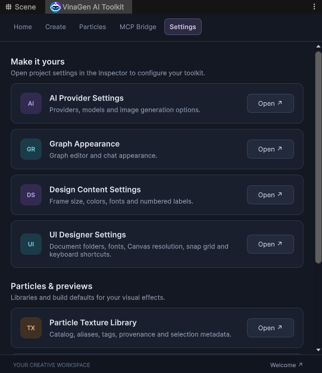

# Settings

Open **Tools → VinaGen AI Toolkit → Open → Settings**, or use the **Settings** menu.

| Setting | Adjusts |
| --- | --- |
| **AI Settings** | Provider, model and credentials. |
| **Graph Appearance** | Graph appearance and web comment name. |
| **Design Content Settings** | Frame, font and callout defaults. |
| **UI Designer Settings** | Document/image folders, fonts, reference resolution, anchors and shortcuts. |
| **Particle Texture Library** | Texture catalog and aliases. |
| **Bundled Particle Library** | Effect prefabs and selection preferences. |
| **Particle WebGL Preview Settings** | Preview pipeline, camera, bloom and captures. |

## Text settings

Open **Tools → VinaGen AI Toolkit → Text → Settings** for:

- **Auto Bake New Texts:** enable automatic baking for new labels.
- **Output Folder:** default `Assets/VinaGen Text Bakes`, outside the toolkit.
- **Shared Atlas:** pack static text images into shared pages.

See [VinaGenText](vinagen-text.md) for rendering modes and benchmark results.

## Settings files

Settings assets live in `Assets/VinaGen AI Toolkit/Settings/` and use the robot icon. Keep provider credentials private; the portable exporter excludes personal settings.

[Next: Folder Layout](folder-layout.md)
