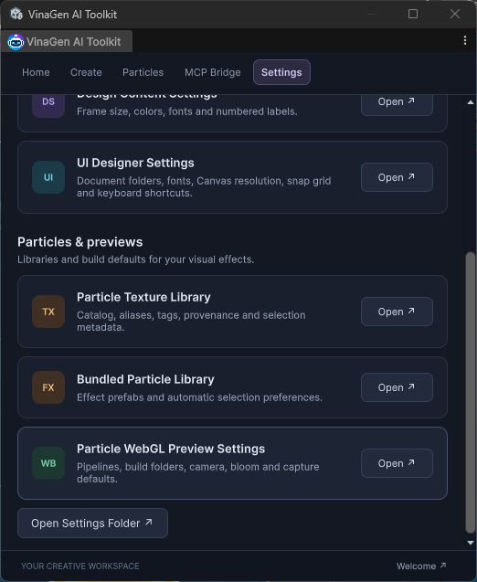
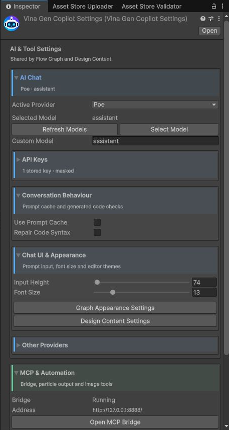
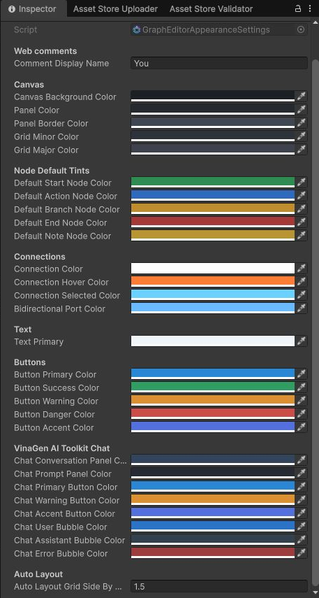
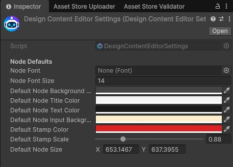
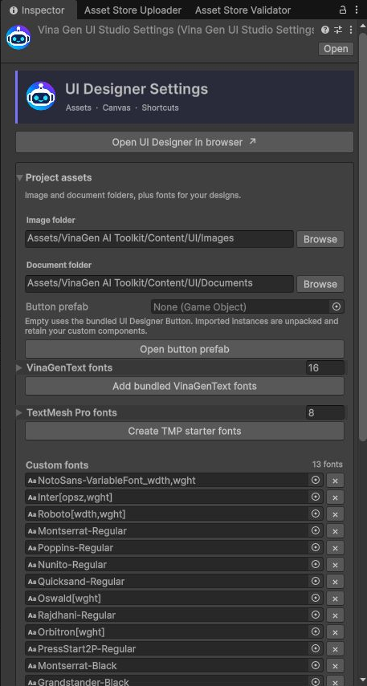
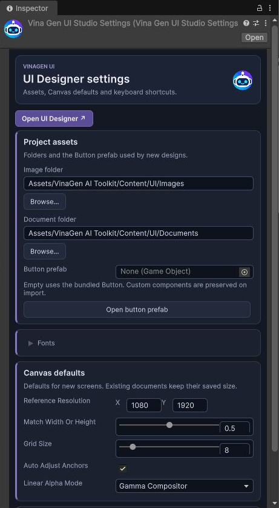
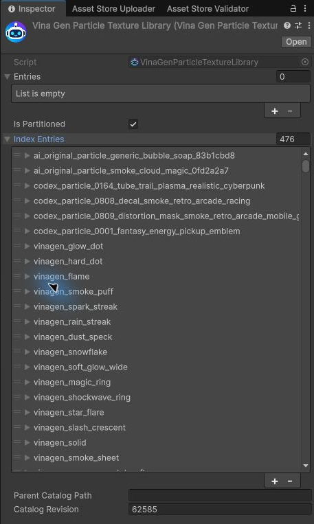
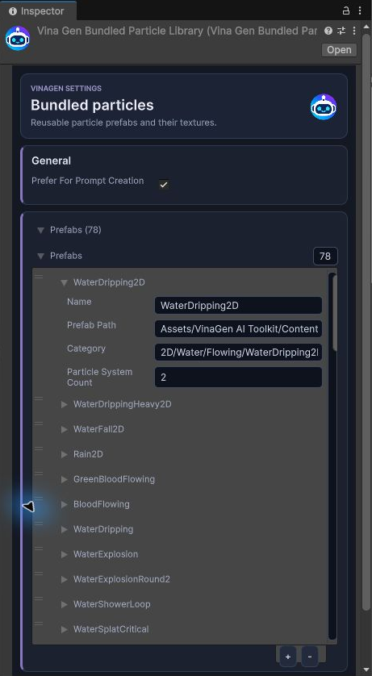
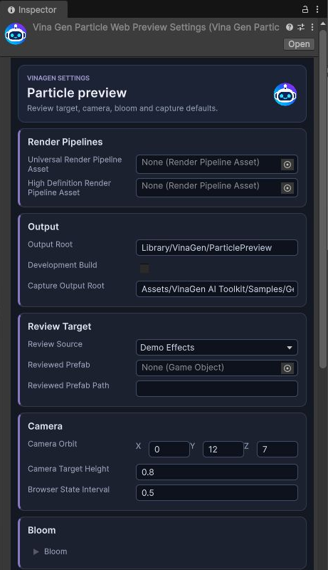
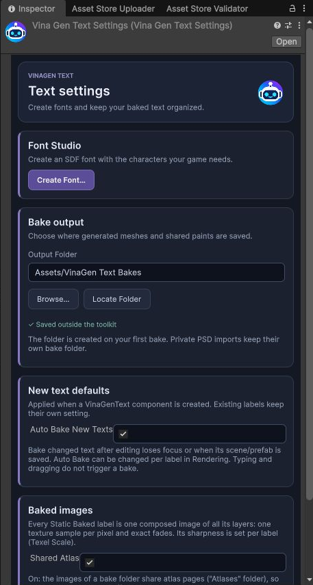

# Settings

Open **Tools → VinaGen AI Toolkit → Open → Settings**. Click **Open** on a card to edit that settings asset in the **Inspector**. Scroll down to see all cards.

  <figure><figcaption>Make it yours: AI, graph, design and UI settings.</figcaption></figure>
  <figure><figcaption>Scroll down: texture and prefab libraries, and Particle WebGL Preview.</figcaption></figure>

Screenshots show a demo project (Unity 6000.3.22f1). Click an image to enlarge it.

## AI Provider Settings

1. Expand **AI Chat** and choose an **Active Provider**.
2. Paste your key in **API Keys**. Keep it private.
3. Click **Refresh Models / Select Model**, or type a **Custom Model**.
4. Open [Agent Chat](ai-chat.md) to start chatting.

Other sections:

- **Conversation Behaviour** — prompt caching and code repair.
- **Chat UI & Appearance** — input size and font.
- **MCP & Automation → Particle Defaults → Particle Output** — where new particles go (web preview, scene or prefab).
- **Image Generation** — image provider options.

Usage is billed by your provider, not the toolkit.

## Graph Appearance and Design Content

  <figure><figcaption>Graph Appearance: comment name, canvas/grid, node and connection colors.</figcaption></figure>
  <figure><figcaption>Design Content: font, colors, numbered stamps and default frame size.</figcaption></figure>

- **Graph Appearance:** your comment name and the graph's colors.
- **Design Content:** default font, stamp color/size and frame size for new screens. Existing screens are not changed.

## UI Designer Settings

  <figure><figcaption>Project assets: destinations, Button prefab and fonts.</figcaption></figure>
  <figure><figcaption>Canvas defaults: resolution, scaling, snap and import behavior.</figcaption></figure>

| Field | What it does |
| --- | --- |
| **Image folder / Document folder** | Where UI images and documents are saved. |
| **Button prefab** | Template for buttons. Leave empty to use the built-in one. |
| **VinaGenText fonts** | **Add bundled VinaGenText fonts** registers the included fonts. |
| **TextMesh Pro fonts** | **Create TMP starter fonts** makes ready-to-use TMP fonts. |
| **Custom fonts** | Drop in your own TTF/OTF fonts. |
| **Reference Resolution** | Default size for new documents. |
| **Match Width Or Height** | 0 = fit width, 1 = fit height. |
| **Grid Size** | Snap grid step. |
| **Auto adjust anchors** | Sets anchors automatically. Turn off to set them yourself. |
| **Linear Alpha Mode** | Fixes color differences in Linear projects. |
| **Keyboard shortcuts** | Customize shortcuts. |

See [UI Designer](ui-designer.md) for Canvas and UI Toolkit import.

## Particle libraries

  <figure><figcaption>Texture library: expand Index Entries to inspect aliases.</figcaption></figure>
  <figure><figcaption>Prefab library: paths, categories and system counts.</figcaption></figure>

- **Particle Texture Library** — the texture catalog. Look under **Index Entries** (**Entries** may be empty; that's normal).
- **Bundled Particle Library** — the included effect prefabs. **Prefer For Prompt Creation** makes the AI reuse them when possible.
- Pink materials? Run **Particles → Repair Materials For Active Pipeline**.

## Particle WebGL Preview Settings

| Section | What it controls |
| --- | --- |
| **Render Pipelines** | Which pipeline the preview uses. |
| **Output Root** | Preview cache (default `Library/VinaGen/ParticlePreview`). |
| **Capture Output Root** | Where captured frames are saved in the project. |
| **Review Target** | Preview the demo effects or a specific prefab. |
| **Camera Orbit / Target Height** | Camera angle and distance. Move back if the effect is cut off. |
| **Bloom** | Glow strength and threshold. |
| **Screenshot → Capture** | Capture timing, size and layout. |

Opening the player never captures anything by itself — an AI agent or a browser command must ask for frames. See [Web Particle](webgl-preview.md).

## Text settings

Open **Tools → VinaGen AI Toolkit → Text → Settings**.

- **Font Studio → Create Font…** — build a font with the characters your game needs.
- **Output Folder** — where baked text images are saved (default `Assets/VinaGen Text Bakes`).
- **Auto Bake New Texts** — new labels re-bake automatically when you finish editing or save.
- **Shared Atlas** — baked labels share texture pages to save memory.

See [VinaGenText](vinagen-text.md) for details.

## Settings files

All settings are in `Assets/VinaGen AI Toolkit/Settings/` (robot icon). **Open Settings Folder** jumps there.

> Never commit files that contain your API keys to Git or share them in packages.

[Next: Folder Layout](folder-layout.md)
