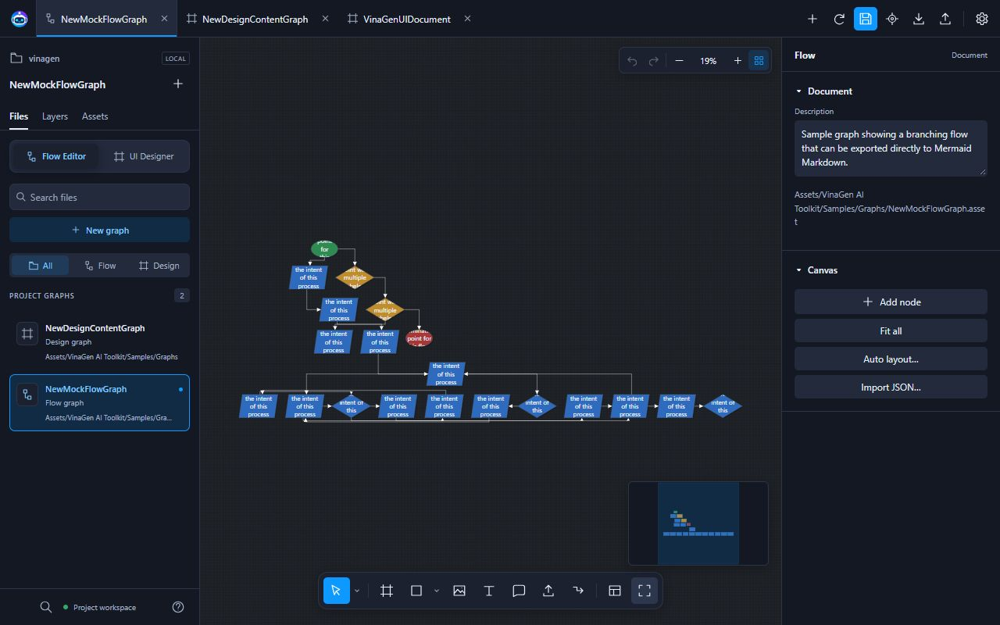
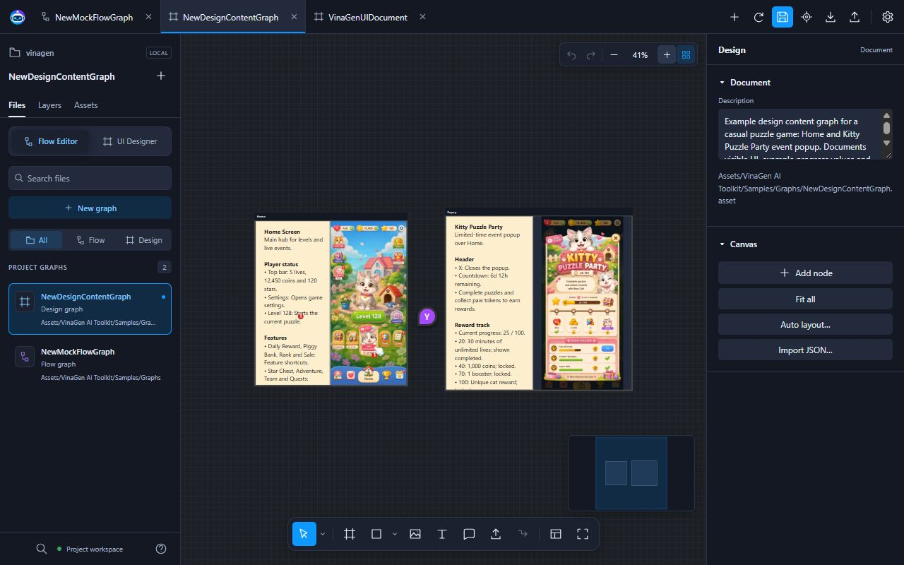

# Flow & Design Graph

Dùng **Flow** để vẽ logic game, dùng **Design** để phác thảo nội dung màn hình.

## Mở editor

Chọn **Tools → VinaGen AI Toolkit → Editors → Open Flow Editor**. Hai loại graph dùng chung workspace trên trình duyệt.

| Asset | Công dụng |
| --- | --- |
| `MockFlowGraph` | Mô tả bước xử lý, điều kiện, nhánh và chuyển trạng thái. |
| `DesignContentGraph` | Mô tả khung màn hình, chữ, ảnh và chú thích đánh số. |

## Vẽ luồng game

1. Tạo Flow graph trong **Files** hoặc mở graph mẫu.
2. Thêm node Start, Action, Decision và End.
3. Kéo giữa các cổng để nối node. Đặt tên nhánh điều kiện, ví dụ **Có / Không**.
4. Bấm **Save asset**.

Flow graph dùng để lập kế hoạch; bạn cần nối logic với code game. FlowCanvas và NodeCanvas là tích hợp tùy chọn.

**Qua MCP:** viết `/vina tạo flow đăng nhập có nhánh thành công và thất bại`. Trợ lý đọc graph bằng `GET /graph?graphType=mock_flow_graph&graphPath=<asset>` rồi gửi thay đổi qua `POST /import` (`import_mock_flow_graph`). `create_block_diagram` / `fix_block_diagram` tạo hoặc sửa graph từ `prompt` thông qua AI Chat của toolkit.

## Phác thảo màn hình

1. Mở hoặc tạo Design graph.
2. Thêm khung màn hình, nội dung chữ và ảnh.
3. Thêm chú thích đánh số để giải thích hành vi.
4. Lưu asset.

Dùng [UI Designer](ui-designer.md) khi cần layer UI chỉnh sửa được và import thành Unity Canvas.

**Qua MCP:** viết `/vina phác thảo màn hình shop gồm danh sách vật phẩm và popup mua`. Đọc bằng `GET /graph?graphType=design_content_graph&whiteFramePath=<asset>`, sửa có phạm vi bằng `patch_design_content_graph`. `create_white_frame` tạo Design graph mới; `update_white_frame` sửa theo `prompt`.

## Viết đặc tả màn hình

Chọn khung Design, bấm **Document editor → Edit document & label images** trong Inspector. Có thể nhấp đúp khung để mở.

<figure>
  
  <figcaption>Viết hành vi màn hình bên cạnh ảnh tham chiếu và chú thích đánh số.</figcaption>
</figure>

| Khu vực | Chức năng |
| --- | --- |
| **Document tabs** | Chuyển tài liệu giữa các màn hình, ví dụ Home và Popup. |
| **Outline** | Di chuyển nhanh tới các heading đã thêm trong tài liệu. |
| **Tài liệu và thanh công cụ** | Viết hành vi, yêu cầu; chỉnh heading, font, danh sách, căn lề, link và ảnh. |
| **Images & labels** | Bấm lên ảnh để thêm nhãn đánh số. Bấm nhãn để sửa; kéo để đổi vị trí. |
| **Export image PNG with labels** | Tải ảnh tham chiếu kèm các nhãn đánh số. |

Ví dụ: nhãn **1** chỉ thẻ sự kiện; mục **1** trong tài liệu giải thích điều kiện mở khóa và hành vi khi bấm. Đóng editor rồi dùng **Save asset** để lưu graph.

**Qua MCP:** `check_white_frame` rà soát khung và sinh mô tả từ ảnh, chú thích. Để trợ lý đọc đúng khung đang chọn trong editor, dùng `get_web_editor_context` rồi `get_node_context`.

## Xuất tài liệu

Xuất **Markdown** để viết đặc tả, **JSON** để giữ dữ liệu hoặc **SVG / PNG** để chia sẻ hình tổng quan.

**Qua MCP:** `GET /graph` trả về dữ liệu graph dạng JSON; `get_document_metadata` trả về outline gọn của node. Markdown, SVG và PNG chỉ xuất được trong editor.

Các action có `prompt` (`fix_block_diagram`, `update_white_frame`, `check_white_frame`) chạy qua [AI Chat](ai-chat.md) nên cần nhà cung cấp AI. Đọc và patch trực tiếp không cần. Xem thêm [MCP Bridge](mcp-bridge.md).

[Tiếp theo: Web Flow Editor](web-editor.md)
