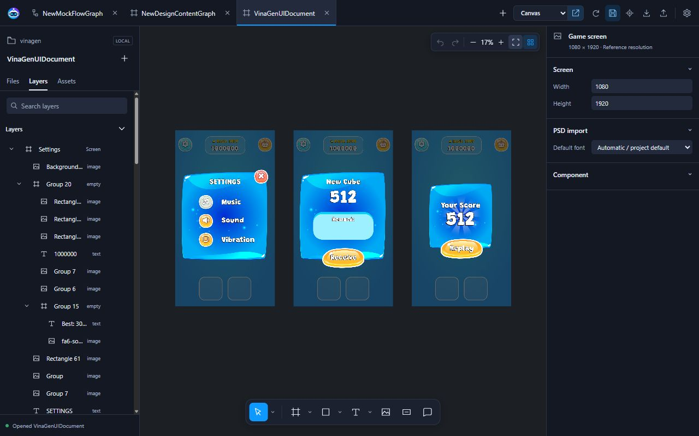
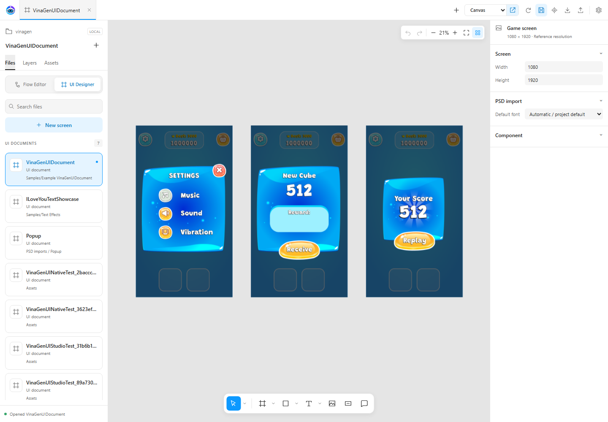
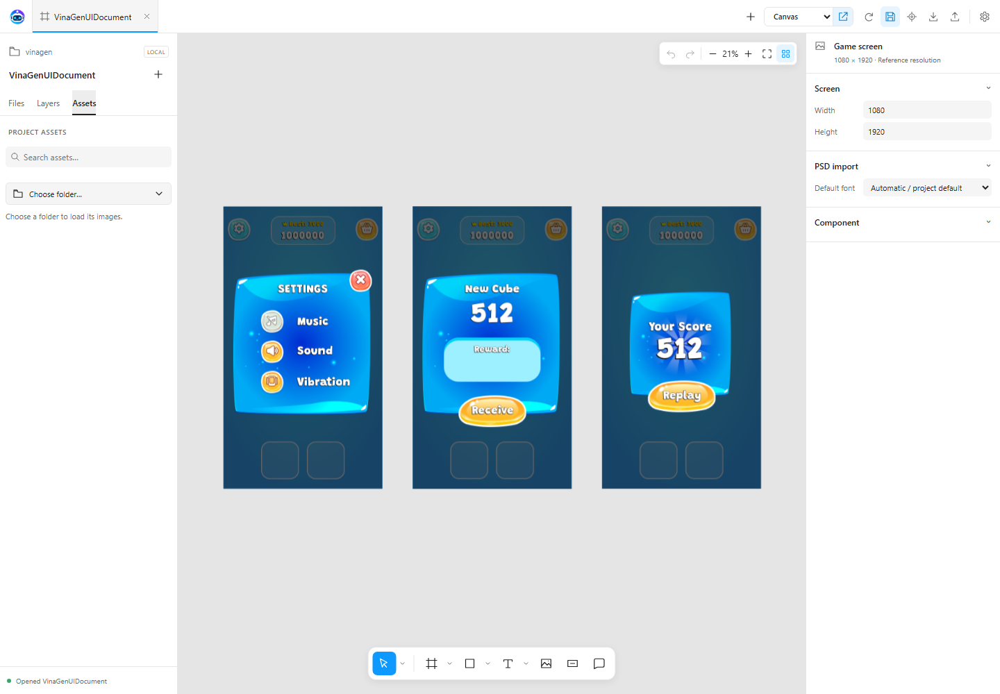
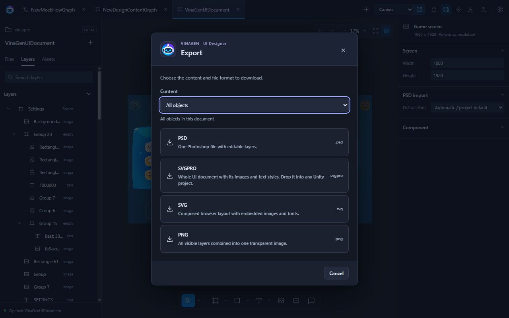
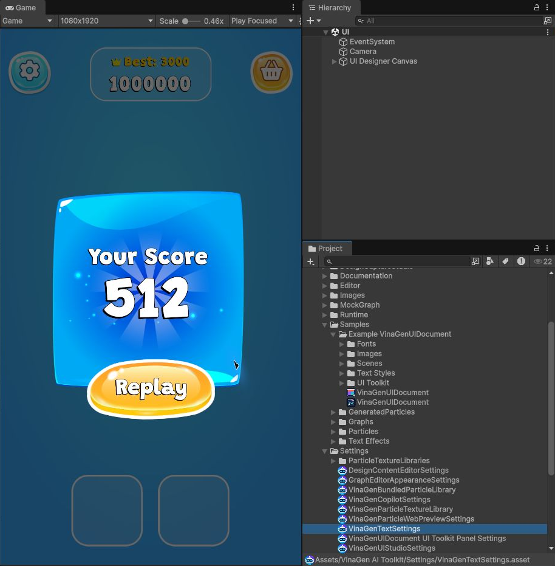

# UI Designer

Dựng màn hình, popup và component UI bằng layer chỉnh sửa được. Xuất ảnh/PSD để chia sẻ, hoặc chuyển thành Unity Canvas để dùng trong game.

## Mở editor

Chọn **Tools → VinaGen AI Toolkit → Editors → Open UI Designer**, hoặc nhấp đúp asset `VinaGenUIDocument`.

## Dựng màn hình

1. Chọn **New screen** hoặc import PSD, JSON, ảnh.
2. Dùng **Root tools → Screen root** cho màn hình chính; tạo root riêng cho từng popup.
3. Thêm ảnh, chữ, nút và nhóm; sắp xếp trong **Layers**.
4. Chỉnh geometry, màu, font, component và anchor trong Inspector.
5. **Save** lưu tài liệu; **Export** tải file; **Canvas** tạo object trong scene Unity.

Chiều rộng và cao của tài liệu đã lưu quyết định kích thước Canvas và Game View. Settings cung cấp mặc định cho tài liệu mới.

## Workspace và layer

| Khu vực | Dùng để |
| --- | --- |
| **Files** | Tạo, mở tài liệu và tìm file trong dự án. |
| **Layers** | Chọn, đổi tên, đổi thứ tự, kéo layer vào cha, ẩn/khóa và thu gọn cây. |
| **Assets** | Chọn ảnh trong Unity rồi kéo vào canvas. |
| **Inspector** | Chỉnh vị trí, kích thước, bố cục, màu, ảnh, chữ và thuộc tính Unity. |
| **Thanh công cụ dưới canvas** | Move, Hand, Scale, Empty/Screen root, hình, Image, Text và Comment. |

Chọn đúng một object rồi vẽ/thả ảnh để tạo con bên trong nó. Bỏ chọn để tạo ở cấp ngoài cùng. Dùng **Add Component** để thêm chức năng cho đối tượng; nhãn Image/Button/Text/Group có phím tắt `Alt+2–5`.

| Layer / component | Khi chuyển vào Unity |
| --- | --- |
| **Empty / Group thường** | Container `RectTransform`, không tự vẽ ảnh. |
| **Image** | `Image`; hình vẽ có fill/stroke dùng `VinaGenUIShape`. |
| **Button** | Image + Button từ Button prefab đã cấu hình. Thêm Text con nếu cần nhãn nút. |
| **Text** | Unity UI Text, TextMeshProUGUI hoặc VinaGenText theo Text type. |
| **Canvas Group** | `CanvasGroup`: opacity, Interactable, Blocks raycasts, Ignore parent groups. |
| **Horizontal / Vertical / Grid** | LayoutGroup tương ứng, giữ spacing, padding và kích thước con. Grid có số cột và kích thước ô. |

Trong **Files**, chọn sample để mở. Trong **Assets**, bấm **Choose folder…** và chọn thư mục ảnh trong dự án; sau đó tìm kiếm và kéo ảnh vào canvas. Nếu chưa chọn thư mục, bảng Assets trống là bình thường. [Demo](demos.md) có bài thực hành ba màn hình.

## Chọn và chỉnh nhiều đối tượng

- **Ctrl/Cmd-click** thêm/bớt từng layer; **Shift-click** chọn một dải trong Layers. Có thể kéo vùng chọn trên canvas.
- Căn lề, phân bố, group, duplicate, copy/paste và đổi thứ tự từ công cụ hoặc menu ngữ cảnh. Paste vào object đang chọn; Duplicate giữ cha cũ.
- **Move** bám cạnh, tâm và khoảng cách đều. `Alt+kéo` bỏ snapping; `Shift+kéo` khóa một trục.
- Kéo cạnh/góc để resize; `Shift` giữ tỉ lệ. **Scale** (`K`) co giãn cả cây con, cỡ chữ và stroke.
- **Selection colors** đổi các màu trùng trong vùng chọn và layer con cùng một lần.

## Ảnh, hình và 9-slice

Thả PNG/JPEG từ máy hoặc kéo ảnh từ **Assets**. **Choose project image / Replace image** gán ảnh; **Reset to image size** trả kích thước gốc.

| Image mode | Kết quả |
| --- | --- |
| **Preserve Aspect** | Giữ tỉ lệ ảnh, vừa trong khung. |
| **None** | Kéo ảnh phủ toàn bộ khung. |
| **9-slice** | Giữ góc/viền, kéo phần giữa; phù hợp panel và nền nút. |

9-slice tự tìm dải pixel lặp trên cả hai trục. Khi Save/import Canvas, nguồn PNG/JPEG độc lập được tối ưu một lần, giữ đường dẫn và GUID; Unity dùng **Image.Type.Sliced** cùng viền sprite. Không áp dụng bước tối ưu này cho atlas/multiple-sprite.

Các hình **Rectangle, Line, Arrow, Ellipse, Polygon, Star** giữ geometry chỉnh sửa được. **Fill** có Solid, Linear, Radial với màu/alpha và 2–8 điểm gradient; **Stroke** chỉnh màu và độ dày. Clip giới hạn phần con tràn khỏi khung.

## Fusion images

Dùng khi muốn gộp nhiều artwork thành một ảnh, còn chữ vẫn sửa được.

1. Chọn **Image, Button hoặc container Group/Empty** có ảnh con.
2. Trong **Image**, bấm **Fusion images**.
3. Đợi gộp và lưu PNG vào dự án. Ảnh được gán lại cho object đang chọn.

Fusion gộp artwork đang hiển thị, gồm fill, transform, clipping và opacity. **Text không bị gộp**; chữ, artwork ẩn và container cần thiết được giữ lại. Các node ảnh đã gộp được loại khỏi cây; vị trí chữ còn lại được giữ.

Ảnh không đổi dùng lại cache; artwork đổi cập nhật PNG Fusion đã sở hữu và giữ GUID. **Undo** khôi phục cây layer, còn PNG đã tạo vẫn ở dự án; Undo tài liệu không khôi phục pixel cũ của file bị ghi đè. Bấm **Save** để lưu tài liệu sau Fusion.

Không Fusion layer Text hoặc cây bị khóa. Lần gộp mới cần ảnh con hiển thị; kết quả cũ có thể dùng lại từ cache. PNG tải vào Unity giới hạn **5 MB**; khi gộp lỗi, cây layer ban đầu được giữ.

## Chữ và font

**Typography → Text type** có **Text**, **TextMesh Pro** và **VinaGenText**. Dùng [VinaGenText](vinagen-text.md) khi cần gradient, viền, độ nổi và bake chữ tĩnh.

Text có căn ngang/dọc, xuống dòng, auto size, spacing, margin và rich text phù hợp renderer. **Text on path / Curve angle** tạo chữ uốn cong. TMP có font/material preset và các thuộc tính shader; VinaGenText có style và hiệu ứng chữ dùng lại được.

Đăng ký font tại **Settings → UI Designer Settings**. **Editors → Create UI Designer TMP starter fonts** tạo font mẫu trong `VinaTextPro/Fonts/TextMeshPro/`. Chỉnh preset qua layer không ghi đè material gốc; đổi **Text type** cần import lại Canvas.

## Import PSD

Import chạy cục bộ, có tiến trình và Cancel. Hỗ trợ **PSD RGB 8-bit**, layer pixel, nhóm, tên, opacity, ẩn/hiện và blend mode được hỗ trợ. Layer chữ có metadata phù hợp được khôi phục thành Text; phần không khôi phục được dùng ảnh và cần kiểm tra lại.

Khi thiếu font, chọn **PSD import → Default font**; font đúng tên trong dự án vẫn được ưu tiên. PSD không chứa file font. Tài liệu, ảnh và style của mỗi import nằm riêng trong `Assets/VinaGen PSD Imports/<tên PSD>/`; giữ font nguồn/font sinh ra thuộc import riêng trong cùng thư mục, không đưa vào default settings hoặc package toolkit.

Kiểm tra mask, smart object, blend mode và hiệu ứng bằng mắt. PSB, CMYK và PSD 16/32-bit chưa được hỗ trợ.

## Export PSD, SVGPRO, SVG và PNG

Trên thanh trên cùng, mở **Export**; nếu thanh được thu gọn, mở **More actions → Export**.

1. Chọn object trên canvas/Layers nếu chỉ xuất một phần.
2. Trong **Content**, chọn **Selected object / Selected objects** hoặc **All objects**.
3. Bấm **PSD**, **SVGPRO**, **SVG** hoặc **PNG** trong hộp thoại để tải định dạng đó.

| Content | Phạm vi xuất |
| --- | --- |
| **Selected object** | Một object và toàn bộ cây con, theo tọa độ cục bộ, bỏ transform/appearance của các cha bên ngoài. |
| **Selected objects** | Nhiều object và cây con; giữ cách sắp xếp giữa các root đã chọn. Chọn cả cha và con không xuất trùng. |
| **All objects** | Toàn bộ tài liệu. Đây là mặc định khi chưa chọn gì; có thể chọn mục này dù đang có vùng chọn. |

Ví dụ: Ctrl/Cmd-click chọn **Shop** và **Popup**, rồi chọn **Selected objects** để xuất chung; chọn **All objects** để lấy cả board. Muốn mỗi màn hình một file, chọn từng Screen root và xuất lần lượt.

| Định dạng | Nội dung file |
| --- | --- |
| **PNG** | Gộp nội dung hiển thị thành một ảnh trong suốt ở kích thước thiết kế 1×. |
| **SVG** | Bố cục trình duyệt, ảnh và font nhúng trong file. Dùng viewer hỗ trợ `foreignObject`; ảnh raster và preview chữ không được chuyển thành vector path. |
| **SVGPRO** | Toàn bộ tài liệu cùng ảnh, text style và font; luôn xuất cả tài liệu. Kéo vào Assets dự án Unity khác để import. |
| **PSD** | Một file có nhóm/layer, tên, thứ tự, opacity, ẩn/hiện và metadata chữ được hỗ trợ. Artwork có dữ liệu raster; font được tham chiếu, không nhúng. |

PSD/SVG/PNG không tự Save tài liệu. SVGPRO lưu thay đổi chưa lưu trước khi xuất gói toàn bộ tài liệu. File PSD có chữ chỉnh sửa được, nhưng Photoshop có thể dựng lại chữ/hiệu ứng khác VinaGen; cần font tương ứng khi sửa. All objects xuất bố cục chung; PNG/SVG bao gồm phần hiển thị tràn khỏi khung tham chiếu.

Giới hạn xuất: **8.192 px mỗi cạnh, tổng 16 megapixel**. PSD thêm giới hạn **1.000 bản ghi layer** gồm cả dấu phân nhóm, **512 ký tự/label** và **500 MB**. Nếu báo thiếu font/ảnh hoặc preview đang chờ, sửa/đợi xong rồi xuất lại; không sửa tài liệu trong lúc export.

## Chuyển vào Unity Canvas

1. Kiểm tra Text type, component, ảnh và Screen root; **Save** tài liệu.
2. Trong Unity, chọn Canvas đích hoặc object bên trong Canvas đó. Không chọn Canvas thì công cụ tạo **Screen Space Overlay Canvas** mới.
3. Chọn **Canvas** trong ô **Unity UI system** trên thanh trên cùng, rồi bấm icon import ngay bên cạnh.
4. Xem Hierarchy và Game View; kiểm tra kích thước, anchor, chữ và tương tác.
5. Nối hành vi Button với game, rồi **tự lưu scene**. Muốn dùng lại màn hình, lưu root đã import thành prefab trong Unity.

Cách khác: chọn asset `VinaGenUIDocument` trong Project, gán **Target Canvas** trong Inspector rồi bấm **Import to Canvas**.

Importer kiểm tra tham chiếu trước khi tạo object. Mỗi lần import tạo hierarchy mới trong một nhóm **Undo**; không tự đồng bộ/xóa các màn hình đã import trước. Undo bỏ object được tạo, còn tài nguyên sinh ra vẫn dùng lại được. CanvasScaler và preset Game View **VinaGen UI Designer** dùng width/height của tài liệu.

### Nhiều màn hình và popup

Tạo **Root tools → Screen root**, hoặc bật **Import as popup** trong menu ngữ cảnh cho container. Mỗi root và cây con trở thành một màn hình độc lập, nằm trực tiếp dưới Canvas và được đặt ở giữa; vị trí xếp cạnh nhau trên board không đẩy màn hình lệch trong Unity.

Root đủ kích thước màn hình dùng **Stretch–Stretch**; popup nhỏ dùng **Center**. Root ẩn import ở trạng thái inactive. Khi có Screen root, layer ngoài các root không được import; không lồng root trong root. Nếu chưa có root, công cụ dùng container cấp ngoài cùng đủ kích thước màn hình hoặc import cả tài liệu dưới một root.

### Anchor, layout và component

**Auto adjust anchors** trong UI Designer Settings suy ra anchor theo vị trí trong cha. Tắt để giữ anchor thủ công; layer bằng kích thước màn hình vẫn được Stretch–Stretch.

**Horizontal / Vertical / Grid** tạo LayoutGroup chạy trong Unity. Auto layout cũ chưa gán loại group chỉ giữ hình chữ nhật đã sắp xếp. **Canvas Group**, clipping, shape, gradient và curve chữ chuyển thành component tương ứng.

Button dùng **UI Designer Settings → Button prefab**: prefab mặc định không có chữ. Prefab riêng có thể giữ component, con, transition và sự kiện của nó; layer cung cấp tên, geometry, ảnh và Interactable.

### Chữ và màu sau import

Trong cùng phiên trình duyệt, chỉnh chữ/style/typography cập nhật đối tượng chữ vừa import gần nhất. Đổi renderer hoặc cấu trúc layer cần import lại; thay đổi này không tự lưu scene.

Ở dự án Linear, **VinaGenUIGammaCompositor** giúp composition gần bản trình duyệt; tốn render target và redraw theo màn hình đang bật. **Linear alpha → Compensate Alpha** trong Settings là cách dùng màu/alpha đã bù với Canvas thường. Material tùy chỉnh/TMP không được compositor hỗ trợ sẽ có cảnh báo và dùng render thường; kiểm tra Game View trên pipeline của dự án.

## Chuyển vào Unity UI Toolkit

1. Dừng Play Mode, thoát Prefab Mode và lưu tài liệu.
2. Trong ô **Unity UI system** trên thanh trên, chọn **UI Toolkit**, rồi bấm nút import tương ứng. Inspector tài liệu cũng có **Import to UI Toolkit** cho asset đã lưu.
3. Kiểm tra UXML trong thư mục **UI Toolkit/** cạnh tài liệu, object **UIDocument** và **VinaGenUIToolkitScreenController** trong scene. Tự lưu scene.

Mỗi lần import tạo asset/object mới và một nhóm Undo; không tự đồng bộ lần trước. Chỉ màn authored-visible đầu tiên bắt đầu hiển thị. Dùng `ShowScreen(layerId)`, `FindLayer(layerId)` và `ButtonClicked` để nối game. Gradient/outline/curve chữ, shape, blend và component uGUI/TMP tùy chỉnh có giới hạn/fallback; đọc cảnh báo và so sánh render. Ảnh demo Canvas ở trên không xác nhận parity UI Toolkit.

## Lưu, cài đặt và review

**Save / Ctrl+S / Cmd+S** ghi `VinaGenUIDocument`, giữ layer, component và tham chiếu asset. **Show in Editor** chọn asset trong Project; khi chưa lưu, có lựa chọn Save and open hoặc Open and discard. Import JSON giữ dữ liệu UI nhưng ảnh/font vẫn cần asset tương ứng trong dự án. Qua [MCP Bridge](mcp-bridge.md), `read_ui_document` trả về dữ liệu `document` để lưu JSON.

Mở **Settings → UI Designer Settings** để chỉnh thư mục, font, Button prefab, độ phân giải mặc định, Auto adjust anchors, Linear alpha và phím tắt. **Comment** ghim ghi chú review, không tạo object Canvas.

Trợ lý có thể dùng `render_ui_web_demo` và `capture_ui_web_screens` để chụp riêng từng màn hình/popup. Các thao tác review không lưu tài liệu hay scene.

[Tiếp theo: VinaGenText](vinagen-text.md)
## Bản web độc lập

Để thiết kế trực tiếp trên website mà không cần Unity, mở
[tab Web Designer](web-designer.md). Bản này có nhập/xuất PSD và chọn thư mục
workspace cục bộ. Phần tích hợp Unity bên dưới thuộc toolkit trong Editor.
