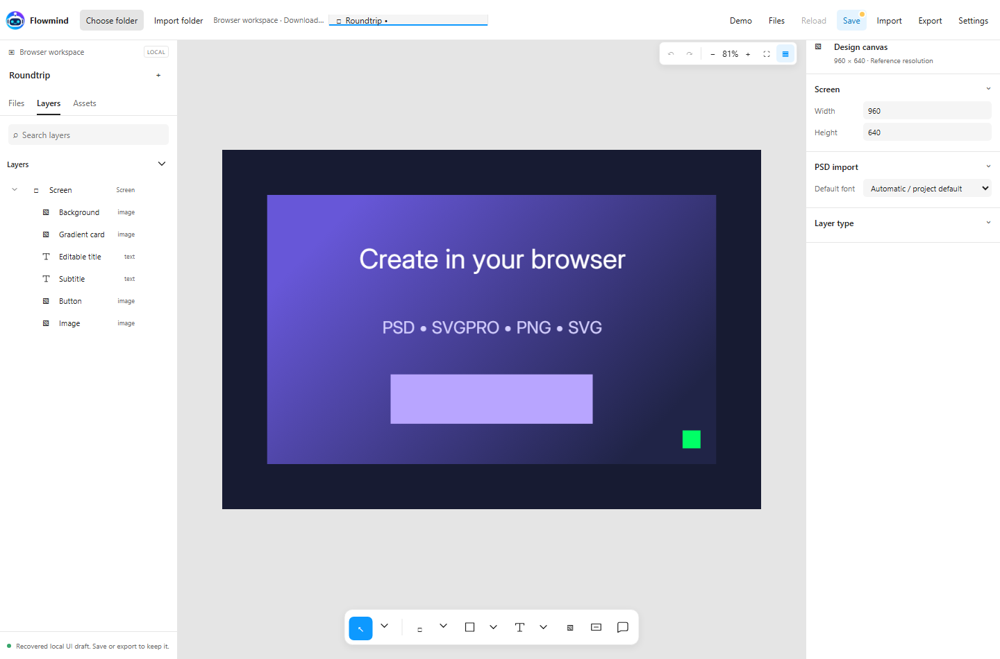
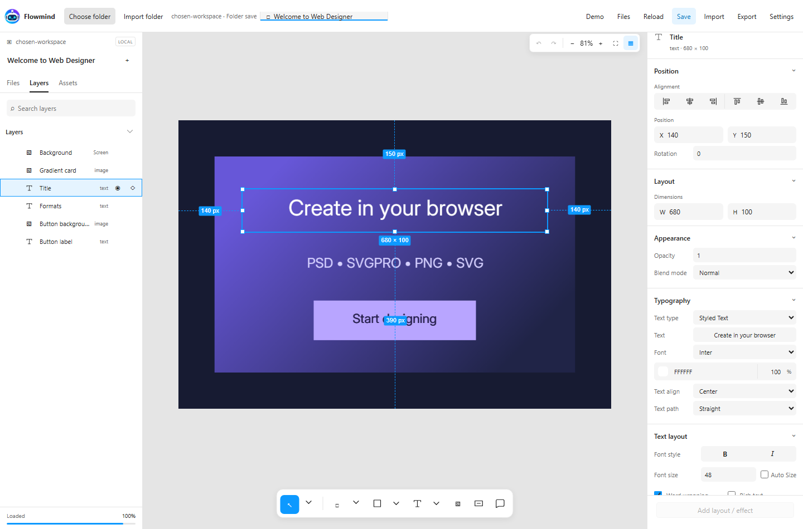
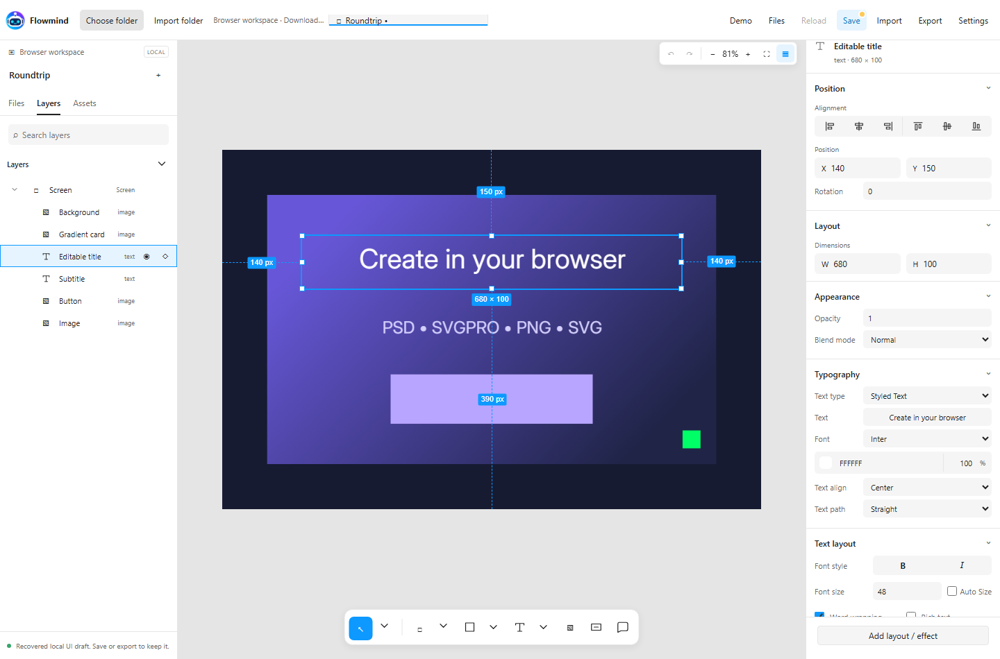
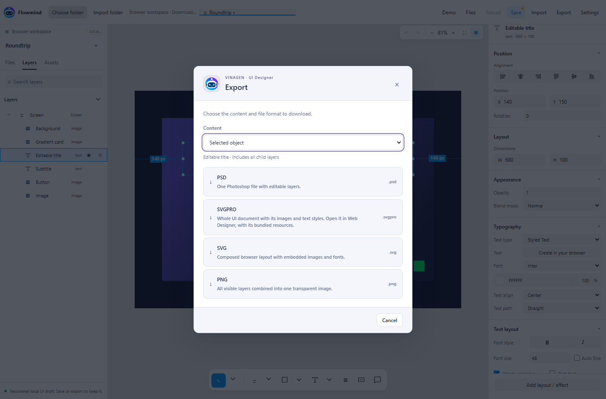
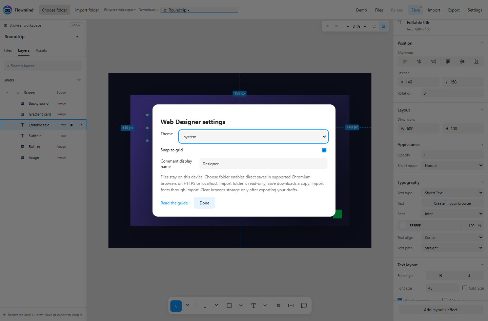

# Web Designer — thiết kế trực tiếp trên web

Thiết kế UI ngay trên website Flowmind. Editor độc lập chạy trong trình duyệt, giữ file trên thiết bị của bạn; không cần cài Unity, chạy bridge, đăng nhập hay cấu hình nhà cung cấp AI.

<a href="designer/" target="_blank" rel="noopener" class="vg-btn">Mở Web Designer ↗</a>

## Chọn thư mục làm workspace

1. Mở editor trong tab trình duyệt riêng. Trên trình duyệt Chromium desktop, bấm **Choose folder** và cấp quyền cho thư mục thiết kế.
2. Nhãn workspace hiện **Folder save**. Tab **Files** liệt kê tài liệu `.svgpro`; **Assets** duyệt ảnh trong workspace. Ảnh, font và tài nguyên PSD mới được lưu cục bộ, rồi đóng gói khi lưu tài liệu.
3. Tạo màn hình, nhập PSD hoặc mở `.svgpro`. **Save** ghi một file `.svgpro` có kèm tài nguyên vào thư mục đã chọn. Tài liệu mới hỏi đường dẫn tương đối, ví dụ `Documents/Login.svgpro`.
4. Khi quay lại website, bấm **Reconnect folder** nếu quyền truy cập đã hết. Hủy hộp chọn thư mục sẽ giữ workspace và bản nháp hiện tại.

Quyền chọn thư mục yêu cầu HTTPS (hoặc localhost), trình duyệt hỗ trợ và thao tác cấp quyền của bạn. Website không thể tự mở thư mục chỉ từ đường dẫn Windows như `C:\Projects\...`. Tham khảo [MDN: showDirectoryPicker](https://developer.mozilla.org/en-US/docs/Web/API/Window/showDirectoryPicker) và [Chrome: File System Access](https://developer.chrome.com/docs/capabilities/web-apis/file-system-access).

Nếu không hỗ trợ ghi trực tiếp, dùng **Import folder** để đọc thư mục, hoặc **Import** để nhập từng file. Trong chế độ **Download save**, Save tải `.svgpro` xuống và lưu bản khôi phục trong trình duyệt; không ghi trở lại thư mục đã nhập. Bạn tự chuyển file tải về vào thư mục mong muốn. Import folder cần trình duyệt hỗ trợ đầu vào thư mục; nhập từng file vẫn dùng được khi tính năng đó không khả dụng.

Editor chỉ truy cập thư mục được chọn. Đường dẫn phải tương đối, không có `..`, ký tự ổ đĩa hay dấu gạch chéo ngược. File có sẵn chỉ được ghi đè khi phiên bản khớp với file đã mở. Nếu ứng dụng khác sửa file, hãy tải lại hoặc lưu tên mới. Mỗi workspace có bản nháp riêng; hãy xuất file trước khi xóa dữ liệu website hoặc đổi trình duyệt/thiết bị.

## Các chức năng thiết kế

Bấm **Demo** để mở màn hình nhỏ gồm shape và text chỉnh sửa được. Chọn tiêu đề,
đổi Typography hoặc fill, rồi xuất PNG/PSD để thử quy trình.

| Khu vực | Chức năng |
| --- | --- |
| Files / Layers / Assets | Mở tài liệu; tìm, đổi thứ tự, lồng nhóm, đổi tên, khóa/ẩn layer; duyệt ảnh |
| Canvas | Di chuyển, pan, scale, resize, xoay, căn chỉnh, snap và Undo/Redo |
| Shape | Chữ nhật, ellipse, polygon, star, line, arrow; stroke và fill solid/linear/radial |
| Text | Nội dung, font, cỡ chữ, khoảng cách, xuống dòng, căn lề, chữ cong và gradient/stroke/outline/extrusion trong trình duyệt |
| Layout | Group, bố cục ngang/dọc/grid và clip phần con |
| Image | PNG/JPEG, chế độ co giãn, 9-slice tự động, cập nhật kích thước nguồn và Fusion |
| Comment | Ghim và chuỗi bình luận cục bộ, lưu kèm tài liệu |

Bấm **Import** để thêm font TTF, OTF, WOFF hoặc WOFF2, rồi chọn trong Typography. Font Inter được đóng gói theo SIL Open Font License. Cập nhật kích thước ảnh thay đổi bản ảnh trong gói tài liệu; ảnh gốc rời trong thư mục workspace được giữ nguyên.

Phím tắt: **V** Move, **H** Hand, **T** Text, **R** Rectangle, **O** Ellipse, **K** Scale, **Shift+1** Fit, **Ctrl/Cmd+S** Save, **Ctrl/Cmd+Z** Undo, **Ctrl/Cmd+Shift+Z** Redo, **Ctrl/Cmd+D** Duplicate. Chuột phải lên layer để copy, paste, tạo nhóm và dùng các lệnh khác. Nên thiết kế trên màn hình lớn; mobile dùng nút Layers và Inspector để mở panel.

## Nhập và xuất PSD

**Import → chọn PSD → Replace hoặc Insert.** Replace hỏi lưu/bỏ bản nháp nếu tài liệu hiện tại có thay đổi. Insert giữ màn hình hiện tại và thêm cây layer PSD bên cạnh. Có thể hủy trong hộp tiến trình; tài liệu trước đó được khôi phục, tài nguyên đã giải mã còn trong cache cục bộ.

Hỗ trợ PSD v1, RGB 8-bit, channel raw/RLE/ZIP; tối đa 500 MB file nguồn, 1000 layer sau nhập, 8192 px mỗi chiều và 16 MP cho canvas/layer. Không hỗ trợ PSB, CMYK và PSD 16/32-bit. Giữ nhóm, thứ tự layer, hiện/ẩn, opacity và blend mode được hỗ trợ. Smart object và vector/effect phức tạp có thể thành ảnh raster hoặc có ghi chú cần kiểm tra.

PSD chỉ chứa tên font, không chứa file font. Hãy nhập riêng font phù hợp. Thiếu font sẽ có cảnh báo fallback; ảnh chữ gốc từ Photoshop được giữ đến khi bạn sửa nội dung, font, kích thước hoặc style. Render chữ, định dạng hỗn hợp, mask và effect Photoshop phức tạp có thể khác; kiểm tra trước khi chia sẻ. Rich-text tag hiện được chuyển thành chữ thường trong renderer styled text; dùng nhiều layer chữ nếu cần định dạng khác nhau.

| Định dạng | Mục đích |
| --- | --- |
| SVGPRO | Tài liệu UI chỉnh sửa được, ảnh và font nguồn tham chiếu trong một gói ZIP; dùng để tiếp tục thiết kế hoặc chuyển máy |
| PSD | Layer Photoshop có metadata text chỉnh sửa được và hình raster; xuất toàn bộ hoặc đối tượng đang chọn |
| PNG | Ảnh gộp nền trong suốt |
| SVG | Bố cục trình duyệt nhúng tài nguyên và `foreignObject`; chữ không chuyển thành vector outline |

**Export SVGPRO** tải bản nháp hiện tại xuống kể cả khi hết quyền truy cập thư mục.
Lệnh này giữ thay đổi chưa lưu và không ghi workspace; kết nối lại rồi dùng Save
để cập nhật file trong thư mục.

Có thể mở gói VinaGen SVGPRO v2 hiện có. Tham chiếu riêng của Unity, shader/material native và script được loại khỏi gói standalone. Đã kiểm tra mở và đóng gói lại tài liệu 205 layer; ảnh nguồn riêng tư không được đưa lên website.

## Settings

**Settings** chỉnh theme, snap và tên hiển thị khi bình luận cục bộ. Chỉnh kích thước canvas trong Screen inspector; thêm font bằng Import. Cài đặt lưu trong trình duyệt này. Chưa có cộng tác cloud, tự tải tài nguyên lên server hay đồng bộ giữa thiết bị.

## Quan hệ với toolkit Unity

Tab này là ứng dụng thiết kế độc lập. Đã bỏ nhập Unity Canvas/UI Toolkit, Show in Editor, thiết lập TMP shader/material, component/raycast native và polling MCP. Hướng dẫn toolkit Unity vẫn ở [UI Designer](ui-designer.md); particle native ở [Web Particle: AI kiểm thử](webgl-preview.md).

**Web Particle phục vụ AI Agent kiểm tra và kiểm thử particle đã tạo**, gồm playback, thời gian và ảnh chụp frame. Đây là phần riêng với UI Designer trên web và vẫn dùng player WebGL native được đóng gói sẵn.

## Hosting và phạm vi kiểm thử

Thư mục tĩnh `designer/` chạy cùng hosting tài liệu Flowmind hiện tại, ở domain gốc hoặc đường dẫn con. Host phải phục vụ `.mjs` dưới dạng JavaScript, giữ các file tương đối và dùng HTTPS để chọn thư mục. Người dùng không cần npm hay dịch vụ Node/Python.

Đã kiểm tra trên Chromium desktop: khởi động độc lập không gọi bridge, đọc/ghi folder handle, từ chối phiên bản cũ/file bị sửa bên ngoài, chặn đường dẫn vượt workspace, đóng gói tài nguyên SVGPRO và khôi phục bản nháp, xuất PSD rồi nhập lại bằng worker, xuất PNG/SVG, bố cục desktop/mobile. Kiểm thử folder handle tự động dùng filesystem riêng của trình duyệt; chưa xác minh hộp cấp quyền của hệ điều hành và hành vi Safari/Firefox. Dùng chế độ tải file khi không hỗ trợ.
