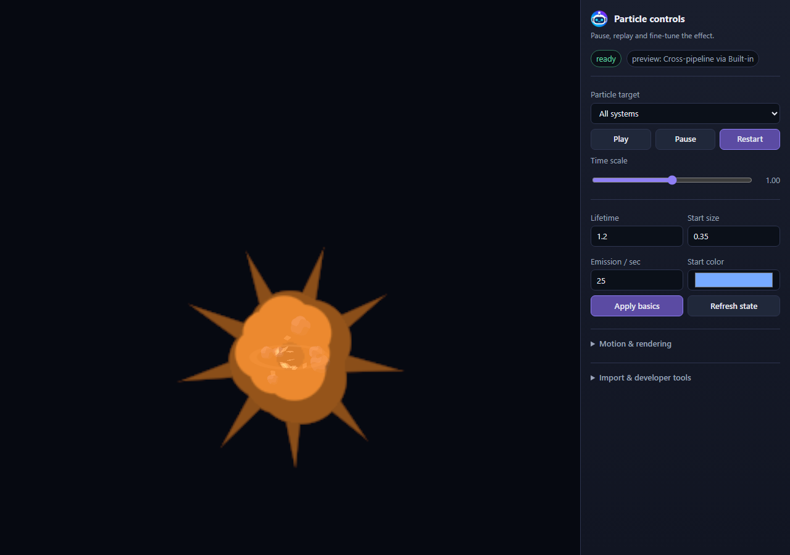
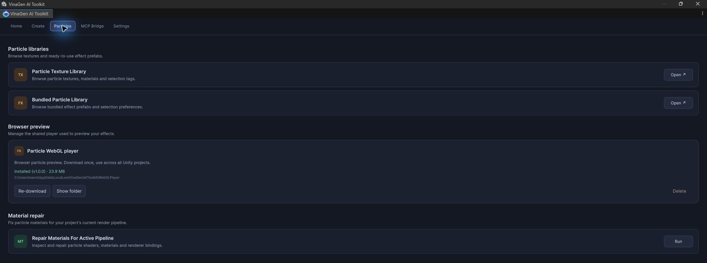
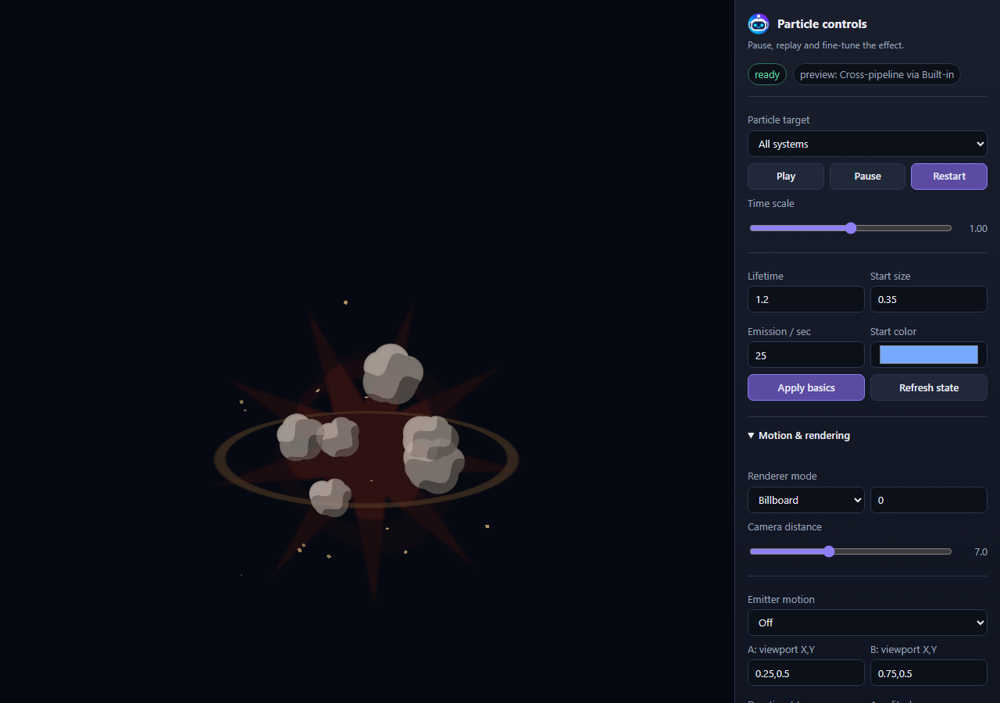
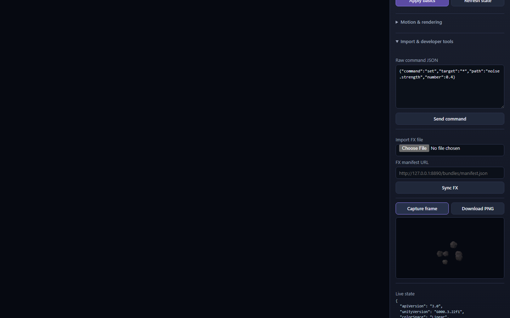

# Web Particle: hỗ trợ AI Agent kiểm thử

**Mục đích chính của Web Particle là hỗ trợ AI Agent kiểm thử trực quan particle mà agent tạo ra.** Agent tải hiệu ứng, đọc trạng thái runtime, chụp thời điểm đã chọn, đánh giá ảnh, chỉnh hiệu ứng trong Unity rồi kiểm thử phiên bản tiếp theo. Người dùng cũng có thể xem và kiểm tra thủ công trên cùng preview.



[Demo trên website](particles.md) minh họa hiệu ứng có sẵn. Preview cục bộ tải prefab/bundle của dự án qua Unity bridge. Điều khiển trình duyệt chỉnh playback live, không tự lưu về prefab Unity. Agent cần áp dụng thay đổi bền vững trong Unity rồi xuất/tải lại phiên bản mới.

## Chuẩn bị player

1. Giữ Unity mở, bật **Open → MCP Bridge**.
2. Mở **Tools → VinaGen AI Toolkit → Open → Particles**. Trong **Particle WebGL player**, bấm **Download** nếu chưa cài. Player được tải một lần, dùng chung cho các dự án trên máy. **Re-download** cập nhật; **Show folder** mở nơi lưu.
3. Cài **WebGL Build Support** chính thức qua Unity Hub khi cần xuất bundle prefab gốc.
4. Mở **Editors → Open Particle Preview → Built-in / URP / HDRP**, hoặc `webPreviewUrl` toolkit trả về cho hiệu ứng.



Cache trên Windows: `%USERPROFILE%/AppData/LocalLow/VinaGen/AIToolkit/WebGLPlayer`. Bundle từng dự án: `Library/VinaGen/ParticlePreview/<Pipeline>/fx/`. Người dùng dùng player dựng sẵn. **Build WebGL** thuộc bộ developer tools riêng dành cho tác giả.

## Vòng lặp kiểm thử của AI Agent

| Bước | Agent thực hiện | Bằng chứng / kết quả |
| --- | --- | --- |
| **1. Tạo** | Chọn artwork/template phù hợp, gọi `create_particle_system` (mặc định `web_preview`). | Đường dẫn prefab, cảnh báo và URL job preview. |
| **2. Đợi và tải** | Poll `webPreviewStatusUrl` đến khi thành công, mở `webPreviewUrl`, đợi sẵn sàng và xác nhận import. | Đúng prefab/phiên bản, hierarchy system và pipeline thực tế. |
| **3. Chụp** | Chọn mốc bắt đầu, đỉnh và tắt dần theo lifetime; dùng seed cố định và kế hoạch chuyển động rõ ràng. | Frame, thời điểm yêu cầu/thực tế và lỗi capture. |
| **4. Đánh giá** | Xem từng ảnh: silhouette, màu, cắt khung, ảnh trống, chồng layer, chuyển động và biến mất. | Nhận xét trực quan cụ thể; API thành công chưa đủ để duyệt hiệu ứng. |
| **5. Cải thiện** | Sửa texture, material, emission hoặc curve trên asset Unity; xuất/tải lại bundle. | Phiên bản đã lưu, rồi chụp lại cùng điều kiện so sánh. |
| **6. Hoàn tất** | Lặp đến khi đúng brief; báo đường dẫn, ảnh, cảnh báo và giới hạn. | Bằng chứng kiểm thử kèm prefab bàn giao. |

Ví dụ yêu cầu trợ lý:

```text
$vina tạo một vụ nổ toon bằng artwork offline, rồi kiểm thử bằng Web Particle.
Chụp lúc bắt đầu, đỉnh và tắt dần với cùng seed. Xem từng ảnh,
sửa lỗi cắt khung hoặc timing, rồi kiểm thử lại prefab Unity đã lưu.
```

Dùng [Tạo từ chat](create-from-chat.md) và [MCP Bridge](mcp-bridge.md) cho quy trình này. Commit Git là thao tác riêng của agent trên host khi được yêu cầu; player WebGL không tự commit code.

## Chụp để so sánh

```js
const fx = window.vinagenParticlePreview;
await fx.waitForReady();
const frames = await fx.capture({
  times: [0.08, 0.18, 0.8], // Ví dụ cho vụ nổ ngắn này; chỉnh theo hiệu ứng.
  simulate: true,
  randomSeed: 12345,
  width: 960,
  height: 640,
  motion: { enabled: false },
  postToSink: false
});
```

Các ảnh camera được chụp trên máy này từ `toon_explosion`, với **seed 12345**, simulation đứng yên và render **Built-in**:

<div class="vg-pair">
  <figure><figcaption>0,08 s — flash đầu và silhouette.</figcaption></figure>
  <figure><figcaption>0,18 s — khối nổ mở rộng và layer khói.</figcaption></figure>
  <figure><figcaption>0,80 s — khói cuối và particle còn lại.</figcaption></figure>
</div>

Đọc `actualTimeSeconds`, metadata pipeline và lỗi cùng với ảnh. Mở/import/theo dõi manifest không tự chụp. `postToSink:true` lưu qua bridge, mặc định tại `Assets/VinaGen AI Toolkit/Samples/GeneratedParticles/Captures/`. `download:true` tải qua trình duyệt. Xem [Particle WebGL Preview Settings](settings.md#particle-webgl-preview-settings) để chỉnh camera, bloom và mặc định capture.

## Điều khiển thủ công và chuyển động emitter

| Điều khiển | Cách dùng |
| --- | --- |
| **Particle target** | Chọn một system hoặc tất cả trước khi chỉnh. |
| **Play / Pause / Restart** | Chạy lại hiệu ứng một lần trước khi đánh giá. |
| **Time scale** | Làm chậm để xem timing và chồng layer. |
| **Lifetime / Start size / Emission / Start color** | Chỉnh live rồi bấm **Apply basics**. |
| **Motion & rendering** | Mở để chỉnh camera distance, renderer mode và đường emitter. |
| **Import & developer tools** | Trong demo website, mở để import bundle/manifest, gửi lệnh, chụp và xem Live state. Player cục bộ có thể sắp xếp khác. |



Dùng **Emitter motion → Arc / Line / Circle…**, đặt A/B, duration rồi **Apply path**. `setMotion` chỉnh chuyển động live mà không chụp; truyền `motion` vào `capture()` để kiểm thử rõ ràng. Chụp đứng yên không chứng minh trail khi di chuyển hoạt động đúng.



## Tương thích và xử lý sự cố

- **Thiếu player:** tải từ Particles hoặc Welcome rồi thử lại.
- **Lệch phiên bản:** player/bundle cần tương thích Unity, pipeline và color space; tải lại release phù hợp. Người dùng không cần dựng player để xử lý.
- **Ảnh trống/bị cắt:** restart, chọn thời điểm trong lifetime hoạt động, kiểm tra framing và `lastError`.
- **Material hồng:** sửa cho pipeline đang dùng rồi tải lại.
- **HDRP:** trình duyệt dùng proxy URP/Built-in. Đối chiếu `expectedRenderPipeline` / `actualRenderPipeline`; kiểm tra shader HDRP gốc trong Unity.
- **Định dạng import:** dùng AssetBundle WebGL gốc/manifest. Không tải trực tiếp YAML `.prefab` hoặc `.unitypackage`.
- **Script riêng / VFX Graph:** script không có trong player dựng sẵn và nội dung VFX không được hỗ trợ không thể kiểm thử bằng player đó.

Các ảnh xác nhận demo Built-in chạy trên máy này; chưa xác nhận tương đương URP/HDRP, hiệu năng thiết bị đích hoặc import Unity sạch chỉ có toolkit.

[Tiếp theo: AI Chat & Nhà cung cấp](ai-chat.md)
