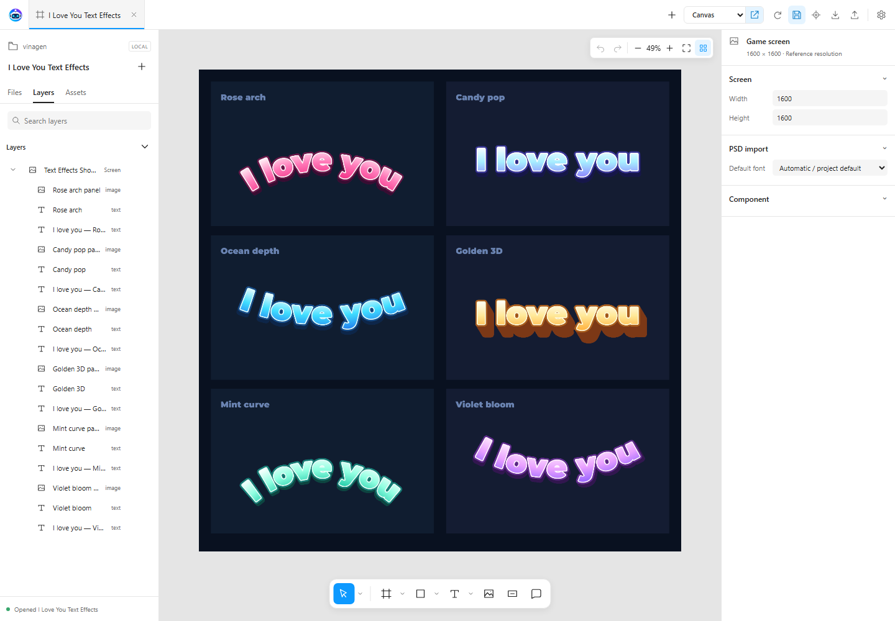

# VinaGenText

UI text with gradients, stroke, outline and extrusion. Choose Dynamic for changing content or Static Baked for fixed labels.

Open `Samples/Text Effects/ILoveYouTextShowcase.asset` to try supplied styles. [Demos](demos.md) walks through practice; [Text settings](settings.md#text-settings) shows Font Studio and bake options.

## What the component can do

| Area | Features |
| --- | --- |
| Text and layout | Font, size, bold/italic, alignment, wrapping, overflow, auto size (min/max), kerning, spacing, margins and curved text (−360° to 360°). Works with Layout Groups through preferred size. |
| Rich text | Ordinary formatting tags: `<b>`, `<i>`, `<u>`, `<s>`, `<color>`, `<size>`, ``, ``, ` `… |
| Face color | Single, Horizontal, Vertical and Four Corners gradients; 2–8 color and alpha keys; Blend or Fixed. |
| Effects | Inner Outline, Stroke, Outer Outline (0–64 px) and 3D Extrusion (−128 to 128 px). |
| Opacity | 0–1, fading text and effects together; multiplied by CanvasGroup. |
| Shared styles | Styles are ScriptableObjects; one edit updates every label using it, including at runtime. |
| Output | Canvas (masks, raycasts, CanvasGroup) or Mesh Renderer for scene text. |
| Editing | UI Designer, Inspector or code (`text`, `color`, `opacity`, `style`…). |

The runtime does not depend on the TextMesh Pro assembly; TMP is used only in the Editor to create or convert fonts.

## Limitations

- **Static font atlas:** characters missing from the atlas do not render. Built-in sets are Latin, Latin + Vietnamese or Custom. Not suited to user input in arbitrary languages (CJK, emoji…).
- **Rich text:** tags that reference named resources are not supported: ``, `<material>`, `<sprite>`, `<style>`.
- **Not a full TMP replacement:** it offers a UI label component API only. TMP fonts must be converted to VinaGen fonts first.
- **Static Baked:** baking runs in the Editor only. At runtime, text and style edits on a baked label are ignored; call `SwitchToDynamic()` first. Labels larger than 1024 px use their own texture instead of the shared atlas.
- **Opacity below 1:** costs one draw call per label; the temporary render is capped at 2048 px per side and larger labels are downscaled. Masks apply to the final result.
- **Effects cost more:** Stroke, Outline and Extrusion draw extra silhouettes (about three times the vertices) and render slower than plain text. Use them for short UI labels, not body copy.
- **Dynamic vs TMP:** slower for text changes, first activation, Layout Groups and auto size; see [Benchmark](vinagen-text.md?id=benchmark-200-labels).
- **Draw calls:** masks, fallback fonts and Canvas ordering can still split batches; one draw call per scene is not guaranteed.
- Changing **Text type** in UI Designer requires importing into the Canvas again.

## Create a label

Use **GameObject → VNT → VinaGenText**, or choose **Typography → Text type → VinaGenText** in UI Designer.

Edit font, size and effects in the Inspector. **New** creates a separate style; editing a shared style updates its users. VinaGen fonts use static atlases: include the characters you need before building.

To create a font, open **Font Asset → Select → Create Font**, choose a TTF/OTF source and **Latin And Vietnamese**, then **Create & Apply**.

Styles, gradients and fonts you create are project output and are saved outside the toolkit, under `Assets/VinaGenGenerated/`:

| Asset | Folder |
| --- | --- |
| Starter styles / styles created with **New** | `Text Styles/Defaults/`, `Text Styles/Manual/` |
| Styles exported from UI Designer | `Text Styles/UI Designs/<design name>/`, `Text Styles/Presets/` |
| Gradients | `Text Gradients/Defaults/`, `Text Gradients/Custom/` |
| Created or imported fonts | `Fonts/VinaGenText/` |

Fonts used by bundled samples and settings stay in `VinaTextPro/Fonts/` inside the toolkit. Styles and gradients left in the toolkit's old `VinaTextPro/Text Styles` and `Text Gradients` folders move out automatically with references preserved; **Tools → VinaGen AI Toolkit → Text → Move Generated Text Assets Out Of Toolkit** runs it again.

## Choose a rendering mode

| Mode | Use it for |
| --- | --- |
| **Dynamic** | Scores, timers and text that changes at runtime. |
| **Static Baked** | Fixed titles, button labels and decorated text. |

Static Baked stores all text effects in one image. It draws one quad per label, supports alpha fades and skips text parsing, layout and style polling at runtime. The current version uses **Composited images**; Geometry baking has been removed.

## Bake fixed text

1. Finish the label's text, font and style.
2. In **Rendering**, choose **Static Baked** and click **Bake / Rebuild**.
3. Keep **Shared Atlas** enabled in **Text → Settings** to share texture pages.
4. Save the scene or prefab. Rebuild stale or unsupported bakes before building.

For a whole hierarchy, select its root and use **GameObject → VNT → Bake All Text (Selection + Children)**. **Revert Bake** returns a label to Dynamic.

**Texel Scale** controls image sharpness: 1 at reference resolution, 2 for high-DPI or enlarged text, with higher texture memory. Baked images are saved to `Assets/VinaGen Text Bakes/`; change **Output Folder** in Text Settings to save elsewhere.

## Built-in optimizations

- **Dynamic activation:** inactive labels delay renderer creation, and renderers are cloned from a prepared template. Re-enabling an unchanged label reuses its previous layout instead of laying the text out again.
- **Dynamic updates:** editing a shared style's face color, gradient, stroke or outline updates its labels without laying out text again (labels without rich-text tags, underline, truncation or sprites). Curved text recolors without re-bending and does not allocate memory each frame. Equal font-atlas/gradient paint can share materials. Use `BeginUpdate()` / `EndUpdate()` for several property changes.
- **Baking:** matching text, fonts and styles reuse bake data. Shared atlases let compatible labels batch together.
- **Mesh Batch:** calling `Refresh()` on labels that have not changed does not rebuild the batch.
- **Auto Bake:** changed labels bake after editing finishes or on scene/prefab save. Unchanged labels are skipped; only changed atlas pages are rewritten. It does not run in Play Mode.

## Combine labels with Mesh Batch

Use **Canvas** for UI that needs masks, raycasts and CanvasGroup. For scene text using **Mesh Renderer**:

1. Put baked labels under the same parent object.
2. Set their **Rendering → Backend → Mesh Renderer**.
3. Add **VinaGen Text Mesh Batch** to the parent through Add Component.

Each atlas page needs one draw call. The group shares sorting; disable **Track Movement** for labels that stay fixed within it, then call the label's `Refresh()` (or the batch's `Rebuild()`) after moving it.

Dynamic labels with opacity below 1 are drawn one draw call per label. For many fading labels, prefer Static Baked.

## Benchmark: 200 labels

Measured on **13 October 2026** in a Windows Release player (Mono, Direct3D 12, Built-in pipeline, Gamma), Unity **6000.3.22f1**, Canvas rendered to a 1280×720 RenderTexture; **i7-14700K / RTX 3060**. Each value is the median, averaged over two interleaved runs.

UGUI and TMP use plain text as a reference. **Plain** is VinaGenText with a face-only style; **Styled** uses the default gradient, stroke, outline and extrusion style.

<table><thead><tr>
<th scope="col">Metric (200 labels)</th>
<th scope="col">UGUI Text</th>
<th scope="col">TextMeshPro</th>
<th scope="col">VinaGenText Dynamic Plain</th>
<th scope="col">VinaGenText Dynamic Styled</th>
<th scope="col">Static Baked</th>
</tr></thead><tbody>
<tr><th scope="row">First activation</th><td>2.50 ms</td><td>5.09 ms</td><td>9.61 ms</td><td>10.49 ms</td><td>—</td></tr>
<tr><th scope="row">Re-activation</th><td>2.25 ms</td><td>3.50 ms</td><td>1.25 ms</td><td>1.32 ms</td><td>—</td></tr>
<tr><th scope="row">Load baked scene</th><td>—</td><td>—</td><td>—</td><td>—</td><td>2.78 ms Canvas 1.50 ms Mesh Batch</td></tr>
<tr><th scope="row">Managed allocation, first activation</th><td>1.8 MB</td><td>3.8 MB</td><td>5.2 MB</td><td>5.2 MB</td><td>—</td></tr>
<tr><th scope="row">Idle frame (whole frame)</th><td>0.13 ms</td><td>0.15 ms</td><td>0.27 ms</td><td>1.64 ms</td><td>0.13 ms</td></tr>
<tr><th scope="row">Change text, all labels</th><td>1.94 ms</td><td>3.38 ms</td><td>5.39 ms</td><td>6.47 ms</td><td>Rebake</td></tr>
<tr><th scope="row">Change color, all labels</th><td>1.78 ms</td><td>3.07 ms</td><td>1.18 ms</td><td>1.32 ms</td><td>—</td></tr>
<tr><th scope="row">Vertices</th><td>9,964</td><td>10,764</td><td>9,964</td><td>29,884</td><td>804</td></tr>
<tr><th scope="row">Draw calls (idle)</th><td>2</td><td>2</td><td>2</td><td>2</td><td>2</td></tr>
</tbody></table>

Static Baked remains the cheapest choice for fixed text. VinaGenText Dynamic is faster than TMP for color changes and re-activation, but slower for text changes, first activation, layout groups and autosize; the effects differ, so TMP is only a reference. Styled labels cost more to render while idle (three times the vertices plus effect shaders). The first label in a new process also pays about **29 + 59 ms** of one-time font and shader initialization.

How these numbers were measured

Activation: SetActive(true) + first Canvas update, warm (after the first run in the process). Re-activation: enabling labels again after disabling them. Change rows: Canvas update time for one frame in which all labels change. Idle frame: whole Release frame including camera render. Managed: Mono heap increase with GC disabled. Vertices and draw calls: Development player. The player hides its window, so GPU time is not reported; profile your target device.

Project source: <code>Documentation/VinaGenTextPerformance/VinaGenText-Comparison-Summary.md</code>.

[Next: Particles & Textures](particles.md)
