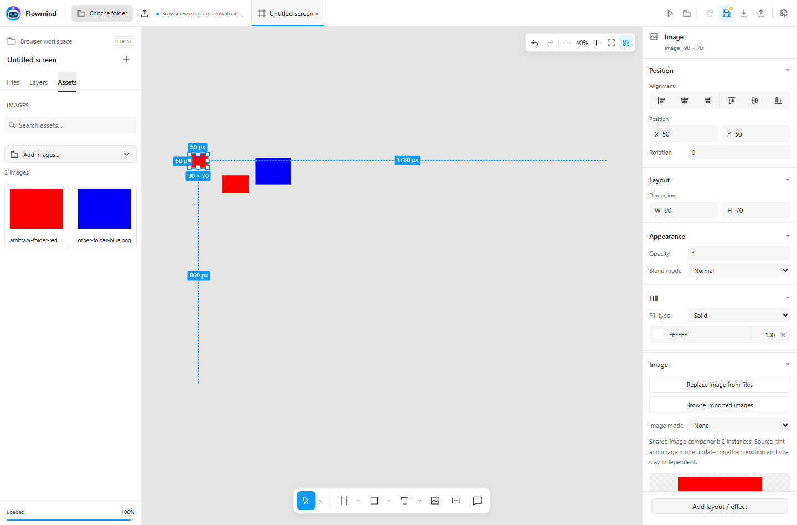
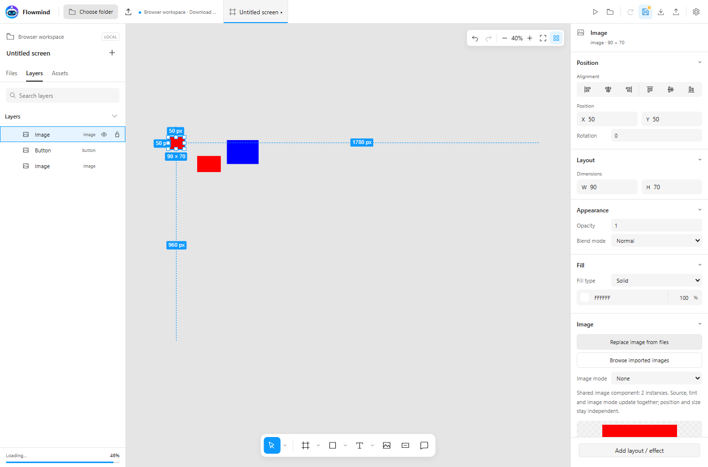

# Web Designer — design online

Create UI directly on the Flowmind website. This standalone editor runs in your browser and keeps your files on your device. It needs no Unity installation, bridge, account, AI provider or runtime server.

<a href="designer/" target="_blank" rel="noopener" class="vg-btn">Open Web Designer ↗</a>

## Start with a workspace

1. Open the editor in its own browser tab. On a desktop Chromium browser, choose **Choose folder** and allow access to your design folder.
2. The workspace label shows **Folder save**. The **Files** panel lists `.svgpro` documents; **Assets** browses workspace images. New images, fonts and PSD resources are cached locally and bundled when you save a document.
3. Create a screen, import a PSD or open an existing `.svgpro`. **Save** writes a portable `.svgpro` into the selected folder. A new document asks for a relative path, for example `Documents/Login.svgpro`.
4. On returning to the site, use **Reconnect folder** when browser permission has expired. Canceling the picker leaves the current workspace and draft intact.

Folder access requires HTTPS (or localhost), browser support and your explicit permission. The website cannot use a typed Windows path such as `C:\Projects\...` as permission to open a folder. See [MDN: showDirectoryPicker](https://developer.mozilla.org/en-US/docs/Web/API/Window/showDirectoryPicker) and [Chrome: File System Access](https://developer.chrome.com/docs/capabilities/web-apis/file-system-access).

If direct folder access is unavailable, use **Import folder** for read-only input, or **Import** for individual files. In **Download save** mode, Save downloads a `.svgpro` and stores browser recovery; it does not write back to the imported folder. Move the downloaded file into your folder yourself. **Import folder** also works on browsers supporting directory file inputs; individual file import remains available otherwise.

Only the chosen folder is accessible. Paths must be relative, without `..`, drive letters or backslashes. An existing file is overwritten only when its revision matches the opened file. If another application changed it, reload or save with a new filename. Drafts are separated by workspace; browser storage is recovery, so export before clearing site data or changing browser/device.

## Design tools

Click **Demo** for a small editable screen made from shapes and text. Select its
title, change Typography or a fill, then export a PNG or PSD to try the workflow.

| Area | What you can do |
| --- | --- |
| Files / Layers / Assets | Open documents; search, reorder, nest, rename, lock and hide layers; browse images |
| Canvas | Move, pan, scale, resize, rotate, align, snap and Undo/Redo |
| Shapes | Rectangle, ellipse, polygon, star, line and arrow; strokes and solid/linear/radial fills |
| Text | Content, font, size, spacing, wrapping, alignment, curved text and browser-rendered gradient/stroke/outline/extrusion effects |
| Layout | Groups, horizontal/vertical/grid layout and clipping |
| Images | PNG/JPEG, scaling modes, automatic 9-slice, source-size updates and Fusion |
| Comments | Pins and local comment threads, included in saved documents |

Choose **Import** to add your own TTF, OTF, WOFF or WOFF2 font, then select it in Typography. Inter is bundled under the SIL Open Font License. Source-size updates change the copy bundled in your document; loose originals in the workspace remain unchanged.

Shortcuts: **V** Move, **H** Hand, **T** Text, **R** Rectangle, **O** Ellipse, **K** Scale, **Shift+1** Fit, **Ctrl/Cmd+S** Save, **Ctrl/Cmd+Z** Undo, **Ctrl/Cmd+Shift+Z** Redo, **Ctrl/Cmd+D** Duplicate. Right-click a layer for copy, paste, grouping and other actions. A larger screen is recommended for editing; mobile uses the Layers and Inspector drawer buttons.

## Image files and shared components

1. Open **Assets** and click **Add images...** to open the device file explorer. Select PNG/JPEG files from any folder, including several files at once. The gallery shows all images imported into this workspace; it no longer asks you to type a fixed folder name. Source files stay on your device.
2. Click or drag a thumbnail onto the canvas. In the Image inspector, **Choose image from files / Replace image from files** opens the file explorer directly; **Browse imported images** uses the existing gallery.
3. Objects with identical decoded pixels and dimensions automatically share one image component, even when filenames or PNG metadata differ. The inspector shows the instance count. Changing the source, tint, gradient or image mode updates every instance in the current document. Position, size, rotation and hierarchy remain independent. Removing an image or deleting an object affects that instance only.
4. **Undo/Redo** restores a shared edit across all instances in one step. Save `.svgpro` to keep the shared references. Replacing a component with an image already used elsewhere joins their instances. Text glyph paint is excluded.

## PSD import and export

**Import → choose PSD → Replace or Insert.** Replace offers a save/discard choice if the current document has unsaved changes. Insert keeps the current screen and adds the imported hierarchy beside it. The progress dialog can cancel; the previous document is restored and already decoded resources remain in local cache.

Supported: PSD v1, 8-bit RGB, raw/RLE/ZIP channels. Source import no longer has the 500 MB or 8192 px / 16 MP caps. PSD v1 itself permits up to 30,000 px per side. Large layers and masks stream by scanline into 1024 px image tiles, with one decoder worker; available memory and local storage still determine practical capacity. The document has a separate 1000-object limit, including tile objects. Very large text rasters retain source metadata but become raster tile groups rather than editable labels. Export and capture limits remain separate from source import limits. A 575 MB, 15,360 x 12,288 px PSD (188.7 MP) was verified in Chromium. PSB, CMYK and 16/32-bit PSD are unsupported. Groups, stacking, visibility, opacity and supported blend modes are retained. Smart objects and unsupported vector/effect details become raster artwork or carry review notes.

PSD stores font names, not font files. Import the matching font separately. Missing fonts show a fallback warning; the cached Photoshop glyph image is preserved until you edit text, font, size or style. Browser text rendering, mixed formatting, masks and complex Photoshop effects may differ; inspect the result before sharing. Rich-text tags currently produce plain text in the styled browser renderer; use separate text layers for different formatting.

| Format | Purpose |
| --- | --- |
| SVGPRO | Editable UI document, images and referenced source fonts in one ZIP package; use it to resume work or move between devices |
| PSD | Photoshop layers with editable text metadata and cached raster appearance; select all objects or a selection |
| PNG | Transparent flattened composition |
| SVG | Browser composition with embedded resources and `foreignObject`; text is not converted to vector outlines |

**Export SVGPRO** downloads the current draft even when folder permission has
expired. It preserves unsaved edits without changing the workspace file; use Save
after reconnecting to update that file.

Existing VinaGen SVGPRO v2 packages can be opened. Unity-only references, native shaders/materials and scripts are excluded from the standalone package. Import/export compatibility was checked with an existing 205-layer document; the private source artwork is not included in this website.

## Settings

**Settings** uses the same popup and Light / Dark / System preview cards as the local editor. Adjust the light canvas background, enhanced contrast, grid snapping and local comment display name. Changes apply immediately and are saved in this browser. Change canvas dimensions in the Screen inspector; import fonts through Import. There is no cloud collaboration, automatic upload or cross-device synchronization.

## Relation to the Unity toolkit

This tab is a standalone design application. Unity Canvas/UI Toolkit import, Show in Editor, TMP shader/material settings, native components/raycast controls and MCP polling are removed. The Unity toolkit remains documented under [UI Designer](ui-designer.md); native particles are documented separately under [Web Particle: AI testing](webgl-preview.md).

The web particle preview exists to help **AI Agents inspect and test generated particles**, including playback, timing and captured frames. It is separate from the browser UI Designer and still uses the shipped native WebGL player.

## Hosting and verified scope

`designer/` is a static folder served alongside the existing Flowmind documentation. It works at the domain root or a project subpath. Serve `.mjs` as JavaScript, keep relative files together and use HTTPS for directory access. There is no end-user npm install or Node/Python service. Developer test tooling is separate.

Verified in desktop Chromium: standalone startup without bridge requests, folder-handle read/write, stale/external revision rejection, traversal rejection, SVGPRO resources and draft recovery, PSD export and worker re-import, PNG/SVG export, desktop/mobile layouts. Folder-handle automation uses the browser's origin-private filesystem; the operating-system permission dialog and Safari/Firefox behavior have not been verified. Use download mode when unsupported.
