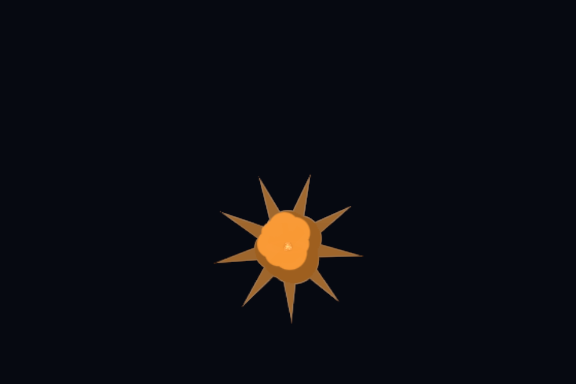
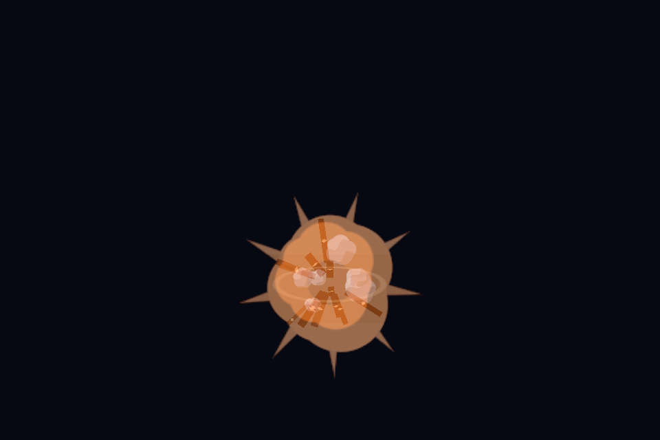
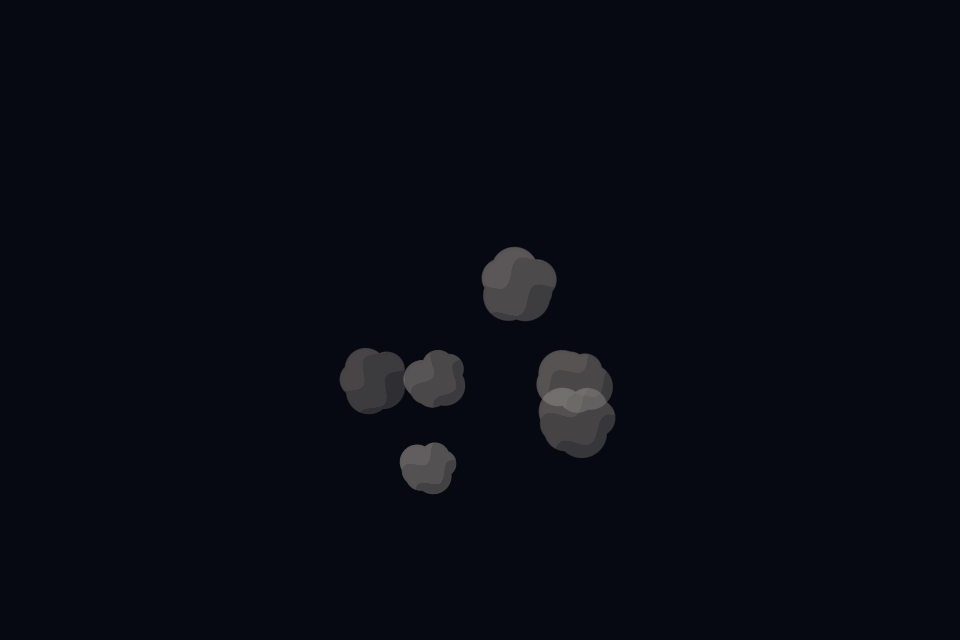

# Web Particle: AI Agent testing

**Web Particle primarily helps an AI Agent visually test the particles it creates.** The agent loads an effect, inspects runtime state, captures selected moments, evaluates the images, adjusts the Unity effect and tests the next revision. Users can also inspect the same preview manually.


The [website demos](particles.md) show supplied effects. A project's local preview loads that project's prefab/bundle through the Unity bridge. Browser controls change live playback; they do not save edits back to a Unity prefab. The agent must apply persistent edits in Unity and export/reload the revision.

## Prepare the player

1. Keep Unity open and start **Open → MCP Bridge**.
2. Open **Tools → VinaGen AI Toolkit → Open → Particles**. Under **Particle WebGL player**, use **Download** if missing. It is downloaded once and shared by projects on this computer. **Re-download** updates it; **Show folder** locates it.
3. Install official **WebGL Build Support** through Unity Hub when exporting native prefab bundles.
4. Open **Editors → Open Particle Preview → Built-in / URP / HDRP**, or the returned `webPreviewUrl` for your effect.


Windows player cache: `%USERPROFILE%/AppData/LocalLow/VinaGen/AIToolkit/WebGLPlayer`. Per-project bundles: `Library/VinaGen/ParticlePreview/<Pipeline>/fx/`. Users use the prebuilt player. **Build WebGL** belongs to the separate author-only developer tools.

## The AI Agent review loop

| Step | Agent action | Evidence / result |
| --- | --- | --- |
| **1. Create** | Choose suitable artwork/template; call `create_particle_system` (default `web_preview`). | Prefab path, warnings and preview job URLs. |
| **2. Wait and load** | Poll `webPreviewStatusUrl` until success, open `webPreviewUrl`, wait for readiness/import acknowledgement. | Correct prefab/revision, system hierarchy and actual pipeline. |
| **3. Capture** | Choose startup, peak and fade times from this effect's lifetime; use a fixed seed and explicit motion plan. | Frames, requested/actual times and capture errors. |
| **4. Judge** | View every frame: silhouette, colors, clipping, empty output, layer overlap, movement and disappearance. | Specific visual findings; API success alone does not approve the effect. |
| **5. Improve** | Edit textures, materials, emission or curves on the Unity asset; re-export/reload its bundle. | Saved effect revision, then captures with the same comparison conditions. |
| **6. Finish** | Repeat until it matches the brief; report paths, images, warnings and limitations. | Review evidence accompanying the delivered prefab. |

Example request:

```text
$vina create a toon explosion with offline artwork, then test it in Web Particle.
Capture startup, peak and fade with the same seed. Inspect every image,
fix clipping or timing problems, and re-test the saved Unity prefab.
```

Use [Create from chat](create-from-chat.md) and [MCP Bridge](mcp-bridge.md) for this workflow. Git commits are a separate host-agent action when requested; the WebGL player does not commit code.

## Repeatable captures

```js
const fx = window.vinagenParticlePreview;
await fx.waitForReady();
const frames = await fx.capture({
  times: [0.08, 0.18, 0.8], // Example for this short explosion; adapt to your effect.
  simulate: true,
  randomSeed: 12345,
  width: 960,
  height: 640,
  motion: { enabled: false },
  postToSink: false
});
```

These camera frames were captured on this computer from `toon_explosion`, with **seed 12345**, stationary simulation and **Built-in** rendering:

<div class="vg-pair">
  <figure><figcaption>0.08 s — initial flash and silhouette.</figcaption></figure>
  <figure><figcaption>0.18 s — expanding body and smoke layers.</figcaption></figure>
  <figure><figcaption>0.80 s — late smoke and remaining particles.</figcaption></figure>
</div>

Read `actualTimeSeconds`, pipeline metadata and errors alongside the images. Opening/importing/watching a manifest never captures frames. `postToSink:true` saves through the bridge to `Assets/VinaGen AI Toolkit/Samples/GeneratedParticles/Captures/` by default. `download:true` requests browser downloads. See [Particle WebGL Preview Settings](settings.md#particle-webgl-preview-settings) for camera, bloom and capture defaults.

## Manual controls and emitter motion

| Control | Use |
| --- | --- |
| **Particle target** | Select one system or all systems before editing. |
| **Play / Pause / Restart** | Replay a one-shot before judging it. |
| **Time scale** | Slow motion to inspect timing and overlap. |
| **Lifetime / Start size / Emission / Start color** | Edit live values, then **Apply basics**. |
| **Motion & rendering** | Expand for camera distance, renderer mode and emitter paths. |
| **Import & developer tools** | In the website demo, expand for bundle/manifest import, commands, captures and Live state. Local player controls may be arranged differently. |


Use **Emitter motion → Arc / Line / Circle…**, set A/B positions and duration, then **Apply path**. `setMotion` changes live motion without capturing; pass `motion` to `capture()` to test it explicitly. Stationary frames cannot establish that moving trails work.


## Compatibility and troubleshooting

- **Missing player:** download from Particles or Welcome, then repeat the request.
- **Version mismatch:** player/bundle must use compatible Unity versions, pipeline and color space; re-download a matching release. Users do not build a player to resolve it.
- **Blank/clipped frame:** restart, choose times inside the active lifetime, check framing and `lastError`.
- **Pink materials:** repair for the active pipeline and reload.
- **HDRP:** browser rendering uses a URP/Built-in proxy. Compare `expectedRenderPipeline` / `actualRenderPipeline`; verify native HDRP shading in Unity.
- **Import format:** use native WebGL AssetBundles/manifests. Raw `.prefab` YAML and `.unitypackage` files cannot load directly.
- **Custom scripts / VFX Graph:** scripts absent from the prebuilt player and unsupported VFX content cannot be verified by that player.

These captures verify the Built-in demo on this machine. They do not establish URP/HDRP parity, target-device performance or a clean toolkit-only Unity import.

[Next: AI Chat & Providers](ai-chat.md)
